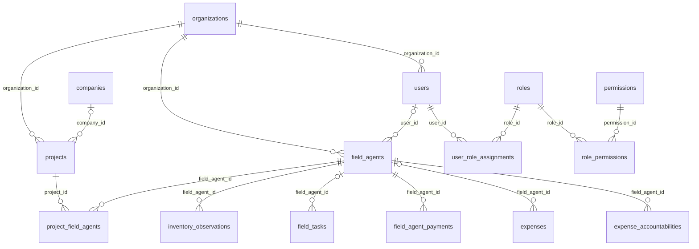

# Auditoria do cadastro e gerenciamento de inventariantes — GAI

**Data de referência:** 04/11/2026, America/Sao_Paulo. **Escopo:** frontend React, backend NestJS/Node.js/TypeORM e MySQL local. **Natureza:** análise técnica e funcional; nenhuma correção implementada.

## Método, evidências e limites

- Repositório inicialmente sem alterações em `git status --short`. Não foram encontrados arquivos `AGENTS.md` na busca incluindo arquivos ocultos do workspace.
- Leitura do código atual, dos testes e das migrations. Referências `arquivo:linha` indicam a versão analisada; os diretórios são relativos à raiz do repositório.
- Conexão direta via `mysql2`, usando silenciosamente a configuração existente em `gai-backend/.env` e os nomes de variáveis usados por `data-source.ts:12`. Credenciais, hashes, tokens e linhas contendo dados pessoais não integram este relatório.
- Banco confirmado: **`gai`, MySQL 8.0.46**. Todas as consultas foram executadas dentro de transações iniciadas com **`START TRANSACTION READ ONLY`**, encerradas com rollback. Foram usados `SELECT`, `information_schema` e `SHOW INDEX`. Nenhuma migration, seed, sincronização de schema ou comando de alteração de dados foi executado. A leitura de metadados TypeORM usou `buildMetadatas()`, sem inicializar o DataSource da aplicação.
- Amostra temporal: consulta retornou `2026-11-05 01:49:35 UTC`, correspondente a **04/11/2026 22:49:35 em São Paulo**. Os testes de vigência também usaram explicitamente `2026-11-04`, evitando depender da data do processo de testes.
- Não houve login, navegação autenticada ou chamadas à API real: até um GET autenticado grava a renovação da sessão, conforme `gai-backend/src/modules/auth/presentation/guards/session-auth.guard.ts:147`. A análise visual é estática, apoiada nos componentes/CSS e testes com API simulada; não equivale a homologação visual em navegador, dispositivos e temas reais.
- Foram executados somente testes unitários sem banco e testes de componentes com endpoints simulados. Suites de integração, seeds e E2E com API real foram apenas inspecionados, pois realizam gravações.
- **Comprovado** significa observado no código, nos metadados, nos agregados do banco ou nos testes executados. **Risco inferido** significa uma consequência possível do código, sem exploração ou gravação. **Regra a definir** significa decisão de negócio não expressa no pedido ou na implementação.

## 1. Resumo executivo

O cadastro possui implementação funcional de criação, edição, consulta, listagem, estados ativo/inativo/bloqueado, exclusão lógica e vinculação a vários projetos. Há permissões por operação, validação de CPF/CNPJ e telefone, prevenção de duplicidade por organização e auditoria transacional. A arquitetura separa cadastro operacional de inventariante, identidade de usuário e atribuições de acesso.

**A regra desejada para `ORG_ADMIN` está implementada no módulo de inventariantes:** organização obrigatória, derivada do contexto autenticado; `organization_id` não é aceito nos DTOs de criação/edição; listagem e operações por ID verificam o escopo. Não foi identificada uma rota direta desse módulo que permita ao `ORG_ADMIN` gerenciar outra organização por simples troca de IDs. Essa conclusão resulta da inspeção; não foi realizado pentest contra a API real.

O principal problema é o **ciclo de desativação e atuação no inventário**: desativar, bloquear ou excluir não altera vínculos ativos; o registro de observações exige apenas um vínculo ativo e não verifica o estado/exclusão do inventariante nem as datas do vínculo. A coordenação de campo aplica essas verificações, criando comportamentos diferentes entre módulos. A conta vinculada também mantém seu estado e sessões quando somente o inventariante é desativado.

O MySQL contém **10 inventariantes, 10 vínculos e 12 eventos de auditoria**. Nenhum inventariante possui `user_id`. Não foram encontrados órfãos nas **56 relações de FK verificadas**, nem divergências de organização nos 18 cruzamentos aplicáveis. Entretanto, **4 documentos preenchidos são inválidos e não normalizados**, **4 inventariantes não possuem evento `CREATE`** e **4 vínculos não possuem evento `ASSIGN_TO_PROJECT`**. A origem dessas lacunas não foi determinada.

Não foi demonstrada falha de severidade **crítica** com acesso entre organizações, execução arbitrária ou exposição de credenciais. Existem achados de severidade **alta** relacionados à interrupção efetiva da atuação e à manutenção da integridade de vínculos após transferência de usuário. A ausência de registros afetados hoje não elimina os riscos do código.

**Validação executada:** 18 testes unitários do backend e 31 testes do frontend passaram. As suites não cobrem integralmente os riscos encontrados; aprovação desses testes não comprova segurança de todo o fluxo.

## 2. Funcionamento completo no frontend

### 2.1 Telas e componentes

| Localização | Responsabilidade e comportamento |
| --- | --- |
| `gai-frontend/src/router/router.tsx:180` e `src/constants/navigation.ts:7` | Rota `/app/field-agents` e item Inventariantes, protegidos por `field-agents:read`. |
| `gai-frontend/src/features/field-agents/FieldAgentsPage.tsx:23` | Lista principal, filtros, paginação, abrir criação/edição/detalhe e confirmar alterações de estado/exclusão. |
| `gai-frontend/src/features/field-agents/FieldAgentForm.tsx:15` | Mesmo formulário em drawer para criação e edição, React Hook Form e Zod. |
| `gai-frontend/src/features/field-agents/FieldAgentDetailDrawer.tsx:7` | Consulta individual, contato, documento, IDs da organização/usuário e datas. Não lista projetos ou eventos de auditoria. |
| `gai-frontend/src/features/field-agents/ProjectFieldAgentsPanel.tsx:25` | Equipe no resumo do projeto; vincular, editar papel/status/período/notas e finalizar vínculo. |
| `gai-frontend/src/features/projects/ProjectSummaryPage.tsx:106` | Exibe o painel conforme `project-field-agents:read`; acesso rápido ao bloco Inventariantes. |
| `gai-frontend/src/features/field-agents/FieldAgentSelect.tsx:13` | Busca remota paginada por inventariantes ativos; usado na vinculação. |
| `gai-frontend/src/features/field-coordination/FieldCoordinationPage.tsx:279` | Responsável de tarefa pode ser usuário administrativo ou inventariante, com escolha de tipo e seleção pelo contexto do projeto. |
| `gai-frontend/src/features/inventory-operations/InventorySessionDetailPage.tsx:159` | Lista/filtra observações por agente; formulário de registro envia `field_agent_id`, inclusive por ID manual em `:204`. |
| `gai-frontend/src/features/finance/ProjectFinancePage.tsx:63`, `PaymentForm.tsx:24`, `ExpenseForm.tsx:20` | Inventariantes como referência em pagamentos/despesas e filtros. Usa lista dos primeiros 100 ativos da organização. |
| `gai-frontend/src/features/users/UserFormPage.tsx` e `UsersPage.tsx` | Fluxo separado para identidade, ativação e perfis. Não há criação automática a partir do formulário de inventariante. |

Os arquivos em `features/field-agents` estão em uso. As funções de validação brasileira também são reutilizadas em empresas e organizações; não são código abandonado. Não foi encontrada uma segunda tela de CRUD concorrente para inventariantes.

### 2.2 Cadastro, edição e validação

O botão **Novo inventariante** exige permissão de criação e `user.organization_id` preenchido (`FieldAgentsPage.tsx:90`). Não existe seletor de organização. Ao salvar com sucesso, invalida-se o cache de inventariantes e fecha-se o drawer. Na edição, os valores vêm da linha selecionada, e não de uma nova consulta individual (`:121`).

| Campo visível | Obrigatoriedade e validação atual | Observações |
| --- | --- | --- |
| Nome | Obrigatório; trim; 2 a 255 caracteres. | Não tem `required` no Input; a exigência é do Zod. |
| Email | Opcional; formato de e-mail. | Frontend não limita a 255; backend limita e converte a minúsculas. |
| Telefone | Opcional; formato brasileiro, máscara e normalização. | Backend limita a 50 e valida novamente. |
| CPF/CNPJ | Opcional; dígitos verificadores, rejeição de repetidos, máscara e normalização. | O verificador atual trabalha com CPF/CNPJ numéricos. |
| Usuário vinculado | Opcional; número inteiro positivo. | ID manual, sem seletor de contas nem confirmação de nome/status/perfis. Ajuda informa corretamente que não cria conta nem concede acesso. |

Evidências: `FieldAgentForm.tsx:46`, `:59`, `:64`; `fieldAgentSchemas.ts:4` até `:31`; `brazilianContact.ts`; DTOs do backend na seção 3. O formulário não expõe `metadata`, `organization_id` nem status inicial.

**Limitação comprovada:** apagar um valor opcional na edição o converte para `undefined` e o remove do payload, portanto o backend conserva o valor anterior. Isso afeta contato, documento, `user_id` e, no painel de projeto, papel/datas/notas. A API suporta `null` para limpar esses campos, mas a UI não o envia (`FieldAgentForm.tsx:72`; `ProjectFieldAgentsPanel.tsx:206`).

### 2.3 Listagem, pesquisa, filtros, paginação e ordenação

- Colunas: nome/ID, email, telefone, documento, status, data de criação e ações (`FieldAgentsPage.tsx:44`).
- Busca por nome, email ou documento; filtro por active/inactive/blocked. Alterar busca/status reinicia a página em 1. Busca principal dispara a cada alteração do texto; não há debounce (`:31`, `:93`).
- Paginação principal de 20 registros. API aceita 1 a 100 por página; UI não permite escolher o tamanho. Não há ordenação interativa por coluna. Backend ordena apenas por `created_at DESC`, sem desempate explícito por ID (`typeorm-field-agent.repository.ts:115`), podendo tornar instável a ordem de datas iguais.
- Busca SQL usa parâmetros, `LOWER` e `LIKE '%termo%'` em nome/email/documento (`repository.ts:108`). Não pesquisa telefone, não remove máscara do termo de documento e não trata `%`/`_` como caracteres literais. Não é uma evidência de SQL injection; é uma limitação de semântica e desempenho da busca.
- Painel do projeto: 10 vínculos por página, sem busca/filtro de status na interface, embora a API aceite status. Vínculos ativos/inativos/finalizados são apresentados juntos (`ProjectFieldAgentsPanel.tsx:31`, `:68`).
- Seletor de inventariante: 20 ativos por página, busca com `useDeferredValue`, anterior/próxima, loading, vazio, erro e repetir. A lista exclui apenas os vínculos ativos presentes na página atual do painel; duplicatas de outras páginas podem aparecer como opção, mas o backend as rejeita (`:44`, `FieldAgentSelect.tsx:17`).

### 2.4 Ações, confirmações, erros e sucesso

Visualizar e editar estão conectados aos endpoints. Para ativo, a UI oferece desativar e bloquear; bloqueado oferece desbloquear; inativo oferece reativar. Excluir está disponível em qualquer estado conforme permissão. Todas as mudanças de estado/exclusão exigem confirmação e mostram estado ocupado (`FieldAgentsPage.tsx:55` até `:79`, `:124`).

A API implementa mais transições que a UI: é possível bloquear um inativo e desativar um bloqueado via API; esses botões não são oferecidos na tela (`field-agent.ts:114`, `:128`). A API não aceita bloquear já bloqueado, desativar já inativo, reativar quem não está inativo ou desbloquear quem não está bloqueado.

Erros de leitura mostram `ErrorState` e repetição na listagem. Erros ao salvar ficam no formulário; conflitos de email/documento são associados ao campo. Outros erros, inclusive telefone/usuário, tornam-se mensagem geral. **Mudanças de estado e exclusão da lista principal não têm mensagem de erro ou sucesso**, nem há handler global de mutations para compensar essa ausência. Em falha, a confirmação pode permanecer aberta sem explicação (`FieldAgentsPage.tsx:130`; `fieldAgentsQueries.ts:40`; `AppProviders.tsx:9`).

No painel do projeto, remover vínculo mostra toast de sucesso/erro e preserva histórico; criar/editar tratam erros no formulário, mas só fecham o drawer no sucesso. O erro `PROJECT_STATUS_BLOCKS_OPERATION` recebe mensagem específica. Projetos fora de draft/active/paused ficam somente para consulta (`ProjectFieldAgentsPanel.tsx:39`, `:46`, `:199`).

### 2.5 Responsividade, acessibilidade e temas

Há suporte estrutural aos temas: tokens `bg-background`, `bg-popover`, `text-muted-foreground`, `border-border` e cores de estado; variáveis claras/escuras em `gai-frontend/src/styles/globals.css:67`; seleção light/dark/system em `src/hooks/useTheme.ts:3` e `src/layouts/Topbar.tsx:86`. Não foi identificada cor fixa problemática específica do módulo que permita afirmar quebra do tema.

A tabela mantém largura mínima de 760px e rolagem horizontal, região focável e orientação no mobile (`components/base/DataTable.tsx:15`). Drawers têm largura `min(100vw,580px)`, altura de viewport e rolagem (`components/ui/dialog.tsx:30`). O cabeçalho do painel se adapta por breakpoint (`ProjectFieldAgentsPanel.tsx:59`). Isso comprova intenção de adaptação, não a qualidade visual final em cada resolução.

Os botões de ícone têm `aria-label`; FormField associa label e erros (`components/base/FormField.tsx:22`). Entretanto, nome obrigatório não exibe indicador visual/semântico `required`, enquanto só usuário é marcado como opcional. `role`, datas e notas do vínculo também não exibem obrigatoriedade de modo uniforme. Detalhe tem rótulo inglês “Organization”, IDs crus e texto técnico sobre GET/ausência de endpoint (`FieldAgentDetailDrawer.tsx:26`, `:31`). Não há visão da equipe por inventariante nem histórico de auditoria no detalhe.

## 3. Estrutura e regras do backend

### 3.1 Organização do módulo

`gai-backend/src/modules/field-agents/field-agents.module.ts:29` registra dois controllers, dez casos de uso, `FieldAgentScopeService`, três entidades TypeORM e o adaptador `TypeOrmFieldAgentRepository`. Integra `AuthModule`, `OrganizationsModule`, `ProjectsModule` e `UserEntity`.

O domínio contém `FieldAgent`, `ProjectFieldAgent` e enums de estado/operação. DTOs de entrada usam class-validator/class-transformer; DTOs de resposta usam snake_case. A implementação não depende de relações ORM navegáveis: carrega referências por IDs/portas e usa FKs criadas pelas migrations.

### 3.2 Endpoints efetivos

Prefixo global **`/api/v1`**, definido em `gai-backend/src/main.ts:13`. Todos os endpoints abaixo usam **SessionAuthGuard + PermissionsGuard**. Os parâmetros de caminho passam por `ParseIntPipe`.

| Método e caminho sem prefixo | Operação | Permissão | Sucesso | Referência do controller |
| --- | --- | --- | --- | --- |
| POST `/field-agents` | Criar ativo na organização autenticada | `field-agents:create` | 201 | `field-agents.controller.ts:70` |
| GET `/field-agents` | Listar com filtros/paginação | `field-agents:read` | 200 | `:90` |
| GET `/field-agents/:id` | Consultar não excluído | `field-agents:read` | 200 | `:104` |
| PATCH `/field-agents/:id` | Alterar dados/usuário/metadados | `field-agents:update` | 200 | `:119` |
| POST `/field-agents/:id/deactivate` | Tornar inativo | `field-agents:deactivate` | 200 | `:137` |
| POST `/field-agents/:id/reactivate` | Inativo → ativo | `field-agents:reactivate` | 200 | `:153` |
| POST `/field-agents/:id/block` | Tornar bloqueado | `field-agents:block` | 200 | `:169` |
| POST `/field-agents/:id/unblock` | Bloqueado → ativo | `field-agents:unblock` | 200 | `:181` |
| DELETE `/field-agents/:id` | Exclusão lógica com auditoria | `field-agents:delete` | 204 | `:197` |
| POST `/projects/:projectId/field-agents` | Criar vínculo ativo | `project-field-agents:assign` | 201 | `project-field-agents.controller.ts:67` |
| GET `/projects/:projectId/field-agents` | Listar vínculos do projeto | `project-field-agents:read` | 200 | `:93` |
| PATCH `/projects/:projectId/field-agents/:assignmentId` | Editar vínculo | `project-field-agents:update` | 200 | `:113` |
| POST `/projects/:projectId/field-agents/:assignmentId/remove` | Finalizar vínculo, sem apagar | `project-field-agents:remove` | 200 | `:141` |

Diretório dos controllers da tabela: `gai-backend/src/modules/field-agents/presentation/`. Não foram encontrados endpoints de restauração de excluído, projetos por inventariante, histórico de auditoria, criação de conta/perfil ou envio de convite dentro desse módulo.

### 3.3 Regras e restrições

**Criação:** obtém organização do ator; exige organização existente/ativa; usuário é opcional, mas, se informado, deve existir e ter a mesma organização. Não verifica estado, perfis ou capacidade de login desse usuário. Nome é aparado; email/documento/telefone são normalizados nos DTOs. Status inicial é sempre active. Verifica conflitos de email/documento e trata colisões concorrentes por índices MySQL. Salva inventariante + evento CREATE em uma transação (`create-field-agent.use-case.ts:48`, `:62`, `:85`, `:93`).

**Atualização:** busca não excluído, verifica organização, valida novo `user_id`, aplica somente valores diferentes de undefined, permite `null` em campos opcionais e não permite trocar organização/status por esse DTO. Confere duplicatas e grava UPDATE com antes/depois. Sem mudanças, retorna sem novo evento (`update-field-agent.use-case.ts:41`, `:53`, `:68`).

**Estados e exclusão:** domínio define transições; casos de uso verificam organização e gravam o cadastro + auditoria. Exclusão preenche somente `deleted_at` e não depende de status ou ausência de vínculos. Não remove referências operacionais/financeiras nem apaga conta; consultas ORM usuais omitem excluídos pelo `DeleteDateColumn` (`field-agent.entity.ts:55`; `field-agent.ts:142`; `update-field-agent-status.use-case.ts:48`; `delete-field-agent.use-case.ts:37`). Não existe restauração por API.

**Vinculação a projeto:** projeto deve existir, pertencer ao ator e estar em draft/active/paused; agente deve existir, estar ativo e ser da mesma organização. Usuário não é necessário. Datas devem ser datas civis válidas e fim não anterior ao início; papel até 100 caracteres; notas opcionais. Não exige que o período inclua hoje. Permite vários projetos e vários vínculos históricos do mesmo par, com **um único vínculo de status active por organização/projeto/agente** (`assign-project-field-agent.use-case.ts:55`; `project-field-agent.dto.ts:15`; `project-field-agent.ts:113`).

**Concorrência:** a persistência revalida o status do projeto sob lock pessimista MySQL; para vínculo ativo também bloqueia a linha do agente e verifica duplicata, além do índice único de chave gerada. Entretanto, não revalida o estado do agente depois do lock, e a alteração de estado do agente não participa da mesma política de bloqueio (`typeorm-field-agent.repository.ts:198`, `:214`, `:250`). Possível corrida de desativação é risco inferido, não executado.

**Edição/remoção de vínculo:** confere projeto autorizado, `assignment.projectId === projectId` e status operacional do projeto. Edição para estado active exige agente ativo e ausência de outro vínculo ativo. Remoção muda para finished; remover já finalizado retorna conflito. Não preenche automaticamente `end_date` (`update-project-field-agent.use-case.ts:62`, `:65`, `:97`; `remove-project-field-agent.use-case.ts:53`; `project-field-agent.ts:98`).

### 3.4 Erros, HTTP e auditoria

- **400 / VALIDATION_ERROR:** DTO inválido, campo extra como `organization_id`, nome inválido, datas invertidas. Pipeline global usa whitelist + transform + forbidNonWhitelisted (`main.ts:22`).
- **401 / UNAUTHORIZED:** sem sessão, sessão inválida/expirada/revogada, usuário inelegível ou organização inativa. Troca obrigatória de senha impede acesso normal com **403 / PASSWORD_CHANGE_REQUIRED**.
- **403 / FORBIDDEN:** permissão insuficiente ou organização incompatível.
- **404 / NOT_FOUND:** inventariante, usuário, projeto ou vínculo não encontrado; excluído lógico fica invisível nas consultas usuais.
- **409 / CONFLICT:** organização inativa na criação, usuário de outro escopo, email/documento duplicado, vínculo ativo repetido, agente inativo na vinculação, transição inválida. Estado de projeto proibido usa **409 / PROJECT_STATUS_BLOCKS_OPERATION**, com detalhe de status.
- **500 / INTERNAL_ERROR:** exceção não traduzida; mensagem genérica. Filtro global: `gai-backend/src/common/filters/http-exception.filter.ts:15`. Conflitos específicos: `field-agents/application/errors/field-agent-conflict.ts:20`.

Auditoria de cadastro e vínculo é gravada na mesma transação da alteração. Criação registra organização/nome/status; associação registra agente/projeto/status. Não registra todos os campos iniciais. Atualizações registram mudanças por campo. Há logs estruturados com operação/IDs/resultado. A interface não oferece consulta aos eventos. O código comprova o mecanismo, mas os dados existentes têm lacunas descritas na seção 4.

## 4. Estrutura real do MySQL e integridade

### 4.1 Tabelas identificadas e contagens

| Tabela real | Finalidade | Registros |
| --- | --- | ---: |
| `field_agents` | Cadastro operacional por organização | 10 |
| `project_field_agents` | Participação e histórico por projeto | 10 |
| `field_agent_audit_logs` | Eventos de cadastro/equipe | 12 |
| `users` | Identidade autenticável, organização e credenciais | 3 |
| `organizations` | Tenant/organização | 2 |
| `projects` | Projeto da organização, referência opcional a empresa | 44 |
| `companies` / `company_units` | Empresas/unidades relacionadas ao projeto | 26 / 8 |
| `roles` / `role_permissions` | Perfis e concessões | 4 / 1 |
| `user_role_assignments` / `permissions` | Atribuições de perfis / catálogo | 3 / 161 |
| `sessions` / `password_reset_tokens` | Sessões / tokens de ativação e recuperação | 115 / 0 |
| `field_tasks` | Tarefas de coordenação com responsável opcional | 2 |
| `inventory_observations` | Coleta atribuída a inventariante | 5 |
| `field_agent_payments` | Pagamentos a inventariantes | 7 |
| `expenses` / `expense_accountabilities` | Despesas / prestações de contas | 8 / 0 |
| `migrations` | Migrations registradas | 36 |

Contagens incluem registros em todos os estados e excluídos lógicos. O anexo A contém colunas, tipos, nulabilidade, defaults, geração, PKs, índices e FKs das tabelas deste recorte, extraídos diretamente do MySQL. As contagens de sessões não significam 115 sessões válidas.

### 4.2 Relacionamentos efetivos



O diagrama resume as referências pertinentes; o anexo é a fonte completa de nulabilidade do recorte. `field_agent_audit_logs` referencia organização e, opcionalmente, agente, vínculo, projeto e usuário executor. Não existe `company_id` no inventariante nem no vínculo: a empresa é indireta via projeto. Não existe tabela separada de associação inventariante–organização: cada linha tem uma única organização.

Nos três objetos centrais, todas as FKs usam **NO ACTION** em update/delete; não há cascata física. Não existe FK composta garantindo que agente, usuário, projeto e vínculo tenham a mesma organização. As FKs simples garantem existência, e o código deve garantir compatibilidade de escopo.

**Unicidade real:** email e documento são únicos por organização, incluindo linhas excluídas logicamente; NULL pode repetir. `user_id` tem índice comum, sem unicidade. Vínculos têm chave `active_assignment_key` armazenada, gerada por concatenação organização/projeto/agente quando status active, e NULL nos demais estados, protegida por índice único. A chave não considera datas ou `deleted_at` do agente. Não existem CHECKs nos três objetos centrais para enumeração de status ou intervalo de datas.

### 4.3 Verificações de dados

| Verificação agregada executada | Resultado | Interpretação |
| --- | ---: | --- |
| Inventariantes ativos / inativos / bloqueados / excluídos | 9 / 1 / 0 / 0 | Distribuição atual; nenhum usuário vinculado. |
| Vínculos active / inactive / finished | 8 / 1 / 1 | Estados independentes do cadastro do agente. |
| Órfãos nas FKs de 17 tabelas relacionadas | 0 em 56 relações | LEFT JOIN contra PK referenciada; não cobre toda tabela de todo o sistema. |
| Divergências de organização em 18 relações aplicáveis | 0 | Inclui agente–usuário, vínculo–agente/projeto, coleta/tarefa/pagamento/despesa e projeto–empresa. |
| Vínculos ativos para agente inativo/bloqueado/excluído | 0 | O risco do código não está materializado nessa amostra. |
| Vínculos ativos fora de vigência em 04/11/2026 | 0 | Considerados início/fim preenchidos. |
| Períodos com fim anterior ao início | 0 | Também validado pelo domínio. |
| Grupos duplicados de email normalizado por organização | 0 | Agrupamento por LOWER(TRIM(email)), desconsiderando vazio/NULL. |
| Grupos duplicados de documento normalizado por organização | 0 | Agrupamento pelos dígitos, desconsiderando vazio/NULL. |
| Grupos com mesmo user_id na mesma organização | 0 | Todos os user_id são NULL; não valida a cardinalidade em uso real. |
| Grupos com múltiplos vínculos active no mesmo par | 0 | Compatível com índice único. |
| Documento repetido entre organizações | 0 | Não há unicidade global; ausência na amostra não é proibição. |
| Documentos preenchidos / inválidos / não normalizados | 4 / 4 / 4 | Verificador atual do backend executado em memória sobre os valores, com saída apenas de totais. |
| Telefones preenchidos / inválidos / não normalizados | 4 / 0 / 0 | Segundo o mesmo verificador atual. |
| Emails preenchidos fora de trim/minúsculas | 0 | Não é validação histórica completa de entrega/formato. |
| Inventariantes sem evento CREATE | 4 | Falta de rastreabilidade; origem não comprovada. |
| Vínculos sem evento ASSIGN_TO_PROJECT | 4 | Falta de rastreabilidade; origem não comprovada. |
| Observações sem qualquer vínculo correspondente | 0 | Compara identidade/projeto/organização; não prova vigência histórica. |

Os 12 eventos atuais são 6 CREATE e 6 ASSIGN_TO_PROJECT. Não há eventos de outras operações nessa tabela. Não se deve concluir que ninguém editou/desativou a partir dessa ausência, pois já existem lacunas de origem. Também não é possível provar a validade do agente em cada coleta passada usando apenas seu estado atual.

### 4.4 Entidades, migrations e MySQL: diferenças

Foram comparados metadados TypeORM e `information_schema` para 17 tabelas relacionadas, quanto a presença de colunas, tipo base, comprimento e nulabilidade. Foram comparados os nomes das 36 migrations carregadas do código com os 36 registros: **nenhuma pendente e nenhuma desconhecida**. Isso confirma nomes/aplicação registrada, não checksum histórico dos arquivos nem ausência de alterações manuais posteriores.

| Objeto | Comparação comprovada | Efeito |
| --- | --- | --- |
| Três tabelas centrais | Colunas/tipos base/nulabilidade coerentes entre entidades e MySQL; coluna gerada presente. | Não foi encontrada coluna central faltante. Defaults e FKs reais estão no anexo; não foi emitida declaração de equivalência completa de todo o schema. |
| `field_agents` | MySQL e migration `1739900000001-create-field-agents.ts:25` têm índices únicos org/email e org/document; `field-agent.entity.ts:17` não os declara. | Schema criado por synchronize/testes pode não reproduzir a proteção real. |
| FKs centrais | Migration/MySQL têm 10 FKs; metadados das três entidades têm zero FKs, pois usam colunas de ID sem relações. | Modelagem por migrations é válida, mas synchronize isolado não reproduz essas garantias. |
| `project_field_agents` | Índice/chave gerada presentes no MySQL, entidade `:19`/`:45` e migration `1740800000001`. Metadata da expressão tem migration própria `1794000000001`. | Proteção real existe; a expressão nos testes SQLite é diferente por dialeto. |
| `users.status` | TypeORM varchar(20); MySQL enum ACTIVE/INACTIVE/LOCKED/BLOCKED/PENDING_ACTIVATION. | Divergência de representação. `auth/infrastructure/persistence/user.entity.ts:58`. |
| `organizations.cnpj` e `status` | TypeORM varchar versus MySQL char(14); status varchar(20) versus enum ACTIVE/INACTIVE. | Divergência adjacente, não falha nova do inventariante. `gai-backend/src/modules/organizations/infrastructure/persistence/organization.entity.ts:25` e `:44`. |
| `roles.type` e `permissions.scope` | TypeORM varchar(20); MySQL enum SYSTEM/ORGANIZATION e PLATFORM/ORGANIZATION. | Evitar assumir equivalência entre testes sincronizados e MySQL migrado. `gai-backend/src/modules/users/infrastructure/persistence/role.entity.ts:27` e `permission.entity.ts:24`. |

Não foram detectadas outras diferenças de coluna nos 17 objetos pelo comparador limitado descrito. Defaults, todos os índices adjacentes e expressões não foram automaticamente normalizados/comparados semanticamente; o anexo preserva a representação real para revisão.

## 5. Campos existentes e finalidade

### 5.1 Cadastro de inventariante

| Campo | Finalidade | Quem define / condições |
| --- | --- | --- |
| `id` | Identificador interno BIGINT UNSIGNED | MySQL auto incremento; tratado como number na aplicação. |
| `organization_id` | Proprietário do cadastro e limite de acesso | Backend pelo ator; NOT NULL; imutável nos DTOs. |
| `user_id` | Referência opcional à conta autenticável | Informado pelo operador; existência/mesma organização; NULL permitido; não é login. |
| `name` | Nome de exibição operacional | Obrigatório; distinto de `users.full_name`. |
| `email` | Contato operacional | Opcional; normalizado; único por organização; não cria credencial/convite. |
| `phone` | Contato brasileiro | Opcional; máscara só na UI; persistência normalizada. |
| `document` | CPF/CNPJ para identificação operacional | Opcional; validação numérica; único por organização. |
| `status` | active, inactive ou blocked | active na criação; endpoints próprios de transição. MySQL usa varchar, sem CHECK. |
| `metadata` | Objeto JSON extensível | Opcional via API, não editável no formulário atual; não há schema de negócio interno. |
| `created_at`, `updated_at` | Rastreio temporal | DATETIME(3), geridos por persistência/MySQL. |
| `deleted_at` | Exclusão lógica | Opcional; preenchido pela exclusão, não zera demais vínculos. |

### 5.2 Participação em projeto e auditoria

`project_field_agents` possui `id`, `organization_id`, `project_id`, `field_agent_id`, `role`, `status`, `start_date`, `end_date`, `notes`, `created_at`, `updated_at` e `active_assignment_key`. Os quatro primeiros identificam a associação/escopo; `role` é **texto de função no projeto**, sem efeito de permissão; `status` é active/inactive/finished; datas são civis opcionais; `notes` guarda observação; a chave gerada implementa a unicidade de vínculo ativo. IDs/organização/agente do vínculo não são alteráveis pelo PATCH.

`field_agent_audit_logs` contém `id`, `organization_id`, `field_agent_id`, `project_field_agent_id`, `project_id`, `operation`, `performed_by`, `changes` e `created_at`. `changes` é JSON obrigatório; `performed_by` identifica o usuário autenticado executor, que não deve ser confundido com o `user_id` do inventariante. Tipos/defaults de cada coluna estão no anexo A.

## 6. Autenticação, permissões, usuários e fluxo completo

### 6.1 Respostas às regras investigadas

| Questão | Comportamento implementado |
| --- | --- |
| Precisa de conta de usuário? | **Não.** user_id é opcional. Os 10 registros atuais não têm conta associada. Cadastro não equivale a acesso. |
| Como é criado/autenticado? | Agente é criado no CRUD operacional. Para login, cria-se separadamente usuário em Usuários, escolhem-se perfis e ativação; depois associa-se o ID. Autenticação usa identificador/senha, Argon2id e sessão opaca persistida, não token JWT inferido. |
| Recebe perfil automaticamente? | **Não.** Não existe perfil de sistema FIELD_AGENT. Enums contêm PLATFORM_ADMIN, ORG_ADMIN e ORG_USER (`user.enums.ts:1`). Perfis organizacionais são possíveis. |
| ORG_USER basta para atuar? | Não automaticamente. Resolver usa permissões dos perfis ativos e compatíveis; no MySQL atual ORG_USER tem zero relações role_permissions. É preciso conceder permissões adequadas por perfil. |
| Papel do projeto concede acesso? | **Não.** É string, sem ligação a roles ou role_permissions. |
| Pode participar de vários projetos? | **Sim.** Associação N:N, com histórico e um active por par/organização, sem restrição a somente um projeto ativo. |
| Pode pertencer a diferentes organizações? | Uma linha de agente tem exatamente uma organização e não pode trocá-la pela API. O mesmo documento pode existir em linhas de organizações diferentes. Conta de usuário tem uma única organização; associação inicial entre organizações é rejeitada. Não há identidade global da pessoa ou associação multiorganização de conta. |
| Desativação remove vínculos? | **Não.** Mantém linhas, status dos vínculos, tarefas, observações e referências financeiras. Não revoga sessão nem desativa o usuário associado. |
| Convite/ativação/troca obrigatória existem? | **Sim no módulo de usuários/autenticação**, sem integração automática com inventariantes. Usuário pode ser PENDING_ACTIVATION por convite ou ACTIVE com senha temporária e must_change_password. |
| Nome/email/telefone sincronizam com usuário? | **Não.** Dados são independentes; não há verificação de igualdade nem propagação observada nos fluxos de criação/atualização. |
| Operador precisa ser o usuário do agente para registrar coleta? | O fluxo atual não exige igualdade; usa agente enviado e salva created_by_id do ator. Isso permite lançamento em nome de outro agente da organização com vínculo ativo, se o operador tem permissão. Necessidade de coleta estritamente pessoal é regra a definir. |

Fontes: `field-agents/application/use-cases/create-field-agent.use-case.ts:62`; `typeorm-field-agent.repository.ts:43`; `users/application/services/user-lifecycle.service.ts:72`; `auth/application/use-cases/login.use-case.ts:23`; `auth/infrastructure/security/argon2-password-hasher.ts:6`; `auth/infrastructure/persistence/typeorm-permission-resolver.ts:56`; `inventory-operations/application/inventory-operations.service.ts:464`, `:532` (todos em `gai-backend/src/modules/`).

Convites utilizam token com finalidade INVITATION, expiração e definição de senha; ativação muda para ACTIVE (`credential-transactions.service.ts:278`). Senha temporária impõe troca antes de acessar funcionalidades, com exceções só para me/logout/password/change no guard. Envio usa o adaptador de e-mail; `UserLifecycleService.options()` distingue disponibilidade real e desenvolvimento pelo mock. Entrega real não foi testada. Não foram lidos valores sensíveis de configuração nem enviado e-mail.

### 6.2 Mapa do fluxo

| Etapa solicitada | Situação atual | Lacuna/condição |
| --- | --- | --- |
| Cadastro | Existe com validação e auditoria | Dados históricos de documento não satisfazem o validador atual. |
| Vinculação à organização | Existe e é obrigatória | Automática pelo ator; plataforma sem organização não cria nesse módulo. |
| Criação/associação de usuário | Associação existe; criação é outro fluxo | Sem assistente integrado, busca de conta ou conferência de status/perfis. |
| Atribuição de perfil | Existe no módulo de usuários/perfis | Nenhum perfil/permissão automático pelo cadastro/vínculo. |
| Vinculação a projeto | Existe | Requer agente ativo/mesma organização e projeto operacional; sem concessão de acesso ao projeto. |
| Atuação no inventário | Existe por observações, tarefas e referências financeiras | Observações não conferem estado/vigência; tarefas conferem. Não existe prova de operação autônoma dos 10 agentes atuais, pois todos estão sem conta. |
| Desativação | Existe como alteração cadastral | Interrupção operacional e de acesso é incompleta; preservação histórica ocorre, mas não é suficiente para impedir novas atuações. |

Manter histórico é desejável e já existe. A correção futura deve separar preservação de referências passadas da elegibilidade para novas operações, sem apagar evidências.

## 7. Isolamento entre organizações

| Superfície | Proteção atual | Avaliação |
| --- | --- | --- |
| Criar agente | resolveOrganizationForCreate retorna actor.organizationId e rejeita NULL; DTO sem organization_id | Atende à regra desejada do ORG_ADMIN. Campo extra é 400 pelo pipeline. |
| Listar agentes | resolveOrganizationFilter força organização do ator; filtro de outra organização é 403 | Atende; não oferece listagem global nem para plataforma sem organização. |
| Consultar/editar/status/excluir | Busca por ID seguida de assertCanAccessOrganization | Bloqueia ação em outro tenant. Consulta inexistente retorna 404 e existente de outro tenant 403, permitindo inferência limitada de existência. |
| Associar usuário | Compara organização do usuário com a do agente; inexistente 404, diferente 409 | Bloqueia associação cruzada na criação/alteração direta. Estado/perfis não são checados. |
| Listar/associar equipe do projeto | Autoriza organização do projeto; associação compara organização do agente | Proteção no caso de uso; listAssignments filtra projeto, sem filtro de tenant adicional. |
| Editar/remover vínculo | Autoriza projeto e confere assignment.projectId | Protege troca de assignmentId entre projetos; depende da integridade persistida de organization_id, sem FK composta. |
| Trocar organização de usuário em Usuários | Plataforma pode transferir, revogar sessões/tokens e exigir perfis compatíveis | Não verifica referências de field_agents existentes; pode produzir vínculo entre tenants após associação válida. Risco inferido, sem exemplo atual. |

Referências: `gai-backend/src/modules/field-agents/application/services/field-agent-scope.service.ts:12`, `:19`, `:35`; casos de uso de get/update/status/delete; `assign-project-field-agent.use-case.ts:62`; `update-project-field-agent.use-case.ts:65`; `list-project-field-agents.use-case.ts:42`; `users/application/services/user-lifecycle.service.ts:166`.

**PLATFORM_ADMIN:** há privilégio diferenciado no guard de permissões (`auth/application/services/permission-access.ts:24`), condicionado à permissão existir no catálogo. Porém o scope de inventariantes **não usa systemRoles para exceções**: um plataforma sem organização recebe 403 em criação/listagem e em acesso a agente de tenant. A própria compatibilidade de perfis exige que PLATFORM_ADMIN tenha organization_id NULL (`users/domain/services/role-assignment-scope.ts:26`). O banco confirma um administrador de plataforma sem organização. A UI pode mostrar a navegação por permissão, mas oculta criar e a API nega consultar. Esse comportamento diverge do módulo de usuários e do serviço de operações de inventário, que têm exceção explícita para plataforma (`inventory-operations.service.ts:1335`).

Isso não é uma brecha de isolamento: é uma limitação/inconsistência de administração. A regra desejada especifica apenas ORG_ADMIN; cabe definir explicitamente se plataforma deve supervisionar globalmente, selecionar tenant de modo controlado ou ficar fora da operação. Nenhuma exceção foi implementada nesta etapa.

## 8. Inconsistências e falhas por criticidade

Critérios: **Crítica** = comprometimento amplo demonstrado; **Alta** = continuidade indevida de operação ou quebra possível de integridade de tenant; **Média** = falha funcional, integridade/rastreabilidade ou proteção incompleta; **Baixa** = usabilidade/desempenho sem comprometimento demonstrado. P0/P1/P2 são prioridades propostas, não autorização para executar.

### A01 — Alta / P0 — Desativação, bloqueio e exclusão não impedem novas observações

**Evidência comprovada:** `gai-backend/src/modules/field-agents/application/use-cases/update-field-agent-status.use-case.ts:69` e `delete-field-agent.use-case.ts:50` gravam apenas agente/auditoria. `gai-backend/src/modules/inventory-operations/application/inventory-operations.service.ts:464` consulta somente project_field_agents active, sem consultar field_agents, deleted_at ou vigência. O insert de observação usa o ID informado em `:518`. `gai-backend/src/modules/field-coordination/field.service.ts:600` faz as verificações adicionais, comprovando divergência.

**Consequência inferida:** operador autorizado pode registrar nova observação atribuída a agente inativo/bloqueado/excluído ou vínculo fora do período se restar associação active. Não foi feita requisição mutante para reproduzir. Banco atual tem zero vínculos ativos com agente inelegível e zero fora de período.

**Correção recomendada:** centralizar elegibilidade (tenant, existência não excluída, status, vínculo e vigência), usá-la em todas as novas operações e revalidar dentro da transação/lock apropriado. Definir se desativar encerra vínculos ou apenas os torna inelegíveis para uso; preservar histórico. Rota afetada: POST `/api/v1/projects/:projectId/inventory-sessions/:sessionId/rounds/:roundId/observations`, protegida por `inventory-observations:create` em `gai-backend/src/modules/inventory-operations/presentation/inventory-operations.controller.ts:173`; a falha requer um operador autenticado e autorizado.

### A02 — Alta / P1 — Transferência de usuário pode invalidar vínculo organizacional já existente

**Evidência comprovada:** `gai-backend/src/modules/users/application/services/user-lifecycle.service.ts:166` até `:193` altera organização/perfis/sessões/tokens, sem verificar field_agents. A compatibilidade agente–usuário só é validada quando user_id é enviado na criação/edição do agente (`create-field-agent.use-case.ts:120`; `update-field-agent.use-case.ts:104`). FKs de `1739900000001-create-field-agents.ts:27` são simples.

**Consequência inferida:** após transferência legítima pela plataforma, uma referência de agente da organização anterior pode apontar para usuário do novo tenant. Não há user_id preenchido hoje; **não há evidência de vazamento efetivo nem de exploração atual**.

**Correção recomendada:** impedir transferência enquanto existirem vínculos incompatíveis ou exigir reconciliação/desassociação explícita e auditada na mesma transação. Rever garantias de integridade por tenant, com política para transferências e concorrência.

### A03 — Média / P1 — Limpar campos opcionais pela UI não persiste

**Evidência:** `gai-frontend/src/features/field-agents/fieldAgentSchemas.ts:4` e `:13` convertem vazio em undefined; `FieldAgentForm.tsx:72` remove undefined/vazio; `ProjectFieldAgentsPanel.tsx:206` repete o comportamento. Domínio preserva campos undefined (`gai-backend/src/modules/field-agents/domain/entities/field-agent.ts:167`).

**Impacto:** usuário não consegue remover telefone/email/documento/conta nem limpar período/papel/notas já gravados. **Recomendação:** distinguir campo não alterado de campo explicitamente apagado e enviar null para os opcionais; cobrir com testes de edição/remoção.

### A04 — Média / P1 — Quatro documentos existentes são inválidos para a regra atual

**Evidência:** consulta de leitura a field_agents e execução em memória de `gai-backend/src/modules/field-agents/domain/validation/brazilian-contact.ts:8` retornaram quatro documentos preenchidos, todos inválidos e não normalizados. `gai-frontend/src/features/field-agents/fieldAgentSchemas.ts:16` valida o documento completo também na edição.

**Impacto inferido:** editar outro campo de um desses registros pode ficar bloqueado até corrigir/remover o documento; A03 dificulta a remoção pela UI. Origem dos dados não determinada. **Recomendação:** inventário/saneamento futuro com aprovação, tratamento de dados legados e mensagem específica; não normalizar cegamente documentos inválidos.

### A05 — Média / P1 — Falhas de estado/exclusão são silenciosas na lista

**Evidência:** `gai-frontend/src/features/field-agents/FieldAgentsPage.tsx:130` registra somente onSuccess da mutation. `fieldAgentsQueries.ts:40` até `:53` não trata erro/feedback, e `src/app/AppProviders.tsx:9` não define fallback global para mutations.

**Impacto:** 403/409/erro de rede não explica por que a ação falhou; sucesso depende de perceber a alteração na tabela. **Recomendação:** mensagem visível no diálogo/toast, tradução consistente e sucesso explícito, mantendo retry e dados do usuário.

### A06 — Média / P1 — Ciclos de conta e agente não são coordenados

**Evidência:** `gai-backend/src/modules/field-agents/application/use-cases/update-field-agent-status.use-case.ts:69` não atua em users/sessions/roles. `auth/presentation/guards/session-auth.guard.ts:87` decide acesso por usuário e organização, sem consultar field_agents. `create-field-agent.use-case.ts:127` verifica só organização da conta; `typeorm-field-agent.repository.ts:43` não busca status/perfis.

**Impacto comprovado de implementação:** bloquear o cadastro operacional não revoga acesso de sua conta; é permitido associar conta inativa/pendente/bloqueada da mesma organização. Hoje não há conta associada. **Regra a definir:** inatividade operacional deve bloquear login ou somente atuação de campo? **Recomendação:** estados independentes com comunicação clara e política explícita; não desativar automaticamente conta administrativa compartilhada sem avaliar seus demais usos.

### A07 — Média / P1 — Lacunas de auditoria e registro inicial incompleto

**Evidência de dados:** quatro agentes sem CREATE e quatro vínculos sem ASSIGN_TO_PROJECT, consultados com NOT EXISTS. **Código:** `gai-backend/src/modules/field-agents/application/use-cases/create-field-agent.use-case.ts:98` registra só organização/nome/status; `assign-project-field-agent.use-case.ts:125` só agente/projeto/status. Atualizações possuem mais detalhes.

**Impacto:** histórico não explica todo o estado inicial nem a procedência de parte dos registros. Não há prova de que o CRUD atual tenha omitido eventos, pois grava transacionalmente. **Recomendação:** investigar origem com trilhas existentes, documentar eventual carga/seed legado, incluir snapshot inicial necessário e disponibilizar leitura autorizada da auditoria; não criar eventos retroativos como se fossem originais.

### A08 — Média / P1 — Modelos sincronizados não reproduzem todas as restrições do MySQL

**Evidência:** `gai-backend/src/modules/field-agents/infrastructure/persistence/field-agent.entity.ts:17` declara apenas três índices comuns; migration `1739900000001-create-field-agents.ts:25` e MySQL possuem dois únicos. As três entidades centrais não declaram FKs; migration/MySQL têm dez. `gai-backend/test/integration/test-app.helper.ts:166` configura SQLite em memória com synchronize no modo não MySQL. Diferenças de enums adjacentes na seção 4.4.

**Impacto:** testes em schema sincronizado podem não revelar colisões/FKs presentes em produção; não é perda comprovada de constraints no banco local. **Recomendação:** alinhar metadados e modelo migrado ou formalizar migrations como fonte das restrições e validar cenários em MySQL descartável separado numa etapa autorizada. Não ligar synchronize no banco da aplicação.

### A09 — Média / P2 — Administração de plataforma sem fluxo coerente no módulo

**Evidência:** `gai-backend/src/modules/field-agents/application/services/field-agent-scope.service.ts:12` e `:35` não dão exceção a PLATFORM_ADMIN; `gai-frontend/src/features/field-agents/FieldAgentsPage.tsx:90` oculta criar sem organização. Resolver de perfis exige plataforma sem organização (`role-assignment-scope.ts:26`), e navegação só verifica permissão (`gai-frontend/src/constants/navigation.ts:7`).

**Impacto:** administrador pode ver item de menu e receber 403 sem alternativa de supervisão. **Recomendação:** definir regra de produto para plataforma e alinhar menu, seleção de escopo e autorização; preservar a regra estrita do ORG_ADMIN.

### A10 — Média / P2 — Exclusão oculta registro, mas reserva identificação e mantém associação ativa

**Evidência:** índices únicos reais de `field_agents` não contêm deleted_at; consulta de conflitos usa ORM sem withDeleted (`gai-backend/src/modules/field-agents/infrastructure/persistence/typeorm-field-agent.repository.ts:68`), e `field-agent.ts:142` só preenche deleted_at. `FieldAgentDetailDrawer` e o painel não oferecem restauração. `ProjectFieldAgentsPanel.tsx:127` passa a exibir “Inventariante indisponivel” se o GET do agente falhar.

**Consequência inferida:** tentar novo cadastro com mesmo documento/email após excluir retorna conflito com um registro invisível; vínculo active antigo continua reservando a chave do par. Histórico perde nome visível no painel. Sem excluídos atualmente. **Recomendação:** política de restauração/reutilização, consulta histórica segura e mensagem que oriente recuperação; não liberar dados por remoção física.

### A11 — Média / P2 — Conta vinculada por ID e cardinalidade indefinida

**Evidência:** `gai-frontend/src/features/field-agents/FieldAgentForm.tsx:64` é Input numérico. `field-agent.entity.ts:19`/MySQL têm índice não único para user_id; não há verificação de conta já associada em `create-field-agent.use-case.ts:62`.

**Impacto:** operador pode escolher conta incorreta; uma conta pode representar múltiplos cadastros sem regra explícita. Isso não é violação comprovada de regra 1:1, pois ela ainda não foi definida. **Recomendação:** seletor remoto com identidade/estado/perfis no próprio tenant e definir cardinalidade antes de adicionar restrição ou automatizar ciclo de acesso.

### A12 — Baixa / P2 — Detalhe e navegação por pessoa incompletos

**Evidência:** `gai-frontend/src/features/field-agents/FieldAgentDetailDrawer.tsx:26` mostra “Organization”/IDs e `:31` expõe instrução técnica de endpoint sem listar projetos. Controllers não oferecem busca de projetos ou eventos por agente.

**Impacto:** difícil revisar alocações e consequências antes de desativar. **Recomendação:** apresentar organização/conta por nome e lista paginada de projetos/histórico autorizados, com estados e avisos de impacto; manter componentes e tokens visuais existentes.

### A13 — Baixa / P2 — Pesquisa e paginação apresentam limitações de escala e consistência

**Evidência:** `gai-frontend/src/features/field-agents/FieldAgentsPage.tsx:31` consulta a cada digitação; `gai-backend/src/modules/field-agents/infrastructure/persistence/typeorm-field-agent.repository.ts:110` usa LIKE contendo sem normalizar documento e `:115` não tem desempate. `ProjectFieldAgentsPanel.tsx:44` exclui só agentes da página visível. `gai-frontend/src/features/finance/financeQueries.ts:24` limita seleção a 100 ativos; `ProjectFinancePage.tsx:64` usa só items.

**Impacto inferido:** busca com máscara pode não achar valor normalizado, requisições excessivas, opções já vinculadas e agentes além dos 100 primeiros inacessíveis no financeiro. Hoje a base é menor que o limite. **Recomendação:** busca normalizada, atraso apropriado, ordenação estável, paginação/busca remota e exclusão de vínculos considerando todo o projeto.

### A14 — Baixa / P2 — Validação visual e contratos de edição não estão completos

**Evidência:** `gai-frontend/src/features/field-agents/FieldAgentForm.tsx:46` não passa required; opcionais de contato não têm indicação. `fieldAgentSchemas.ts:5`, `:33` não limitam email/papel nem refinam intervalo de datas, enquanto DTOs backend limitam a 255/100 e domínio valida período.

**Impacto:** erros chegam tardiamente, obrigatoriedade pouco clara; backend ainda protege o contrato. **Recomendação:** alinhar schemas e indicadores acessíveis ao backend, mantendo validação no servidor.

### A15 — Média / P2 — Cobertura insuficiente para a matriz de isolamento e ciclo completo

**Evidência:** `gai-backend/test/integration/field-agents/field-agents.e2e-spec.ts:305` testa leitura cruzada, mas a suite inspecionada não apresenta matriz equivalente para todas as mudanças de estado, exclusão, listagem filtrada e associação de usuário. `:390` bloqueia agente antes de vinculá-lo, sem testar coleta após bloquear agente já vinculado. `gai-frontend/src/features/field-agents/FieldAgentsPage.test.tsx:108` não cobre limpeza de opcionais/erro de desativação. Testes existentes estão detalhados na seção 9.

**Impacto:** regressões podem passar pelas suites atuais. **Recomendação:** acrescentar cenários negativos e de concorrência após autorização de implementação, em ambientes isolados; incluir dados legados e os efeitos operacionais de bloqueio/exclusão.

### A16 — Baixa / P2 — Caminhos legados de ativação de usuários permanecem registrados

**Evidência:** `gai-backend/src/modules/users/users.module.ts:71` registra `DeactivateUserUseCase` e `ActivateUserUseCase`; a busca de referências em `src/modules/users` encontra definições/registro, mas o controller chama `UserLifecycleService.setStatus` diretamente em `presentation/users.controller.ts:203` e `:219`. O construtor em `:64` não injeta os casos de uso legados.

**Impacto:** duplicação de regras adjacentes ao ciclo de conta, com risco de manutenção divergente se esses caminhos voltarem a ser usados. Não há prova de execução desses caminhos pelo fluxo HTTP atual. **Recomendação:** revisar consumidores e consolidar o ciclo em uma implementação após autorização; não associar automaticamente esses serviços ao inventariante sem definir a política de acesso.

## 9. Funcionalidades existentes, parciais, ausentes e testes

### 9.1 Matriz funcional

| Funcionalidade | Estado | Evidência/limite |
| --- | --- | --- |
| CRUD, estados e exclusão lógica | Existente | Endpoints e botões conectados; feedback e efeitos operacionais incompletos. |
| Escopo ORG_ADMIN derivado do contexto | Existente | Scope, DTOs e guards; transferência posterior de usuário é outra superfície. |
| Validação de contato e unicidade por tenant | Existente | DTOs/índices MySQL; dados legados inválidos e metadados ORM incompletos. |
| Paginação e busca de agentes | Existente | Sem ordenação configurável; limitações descritas em A13. |
| Equipe por projeto, papel, período, histórico | Existente | Papel é descritivo, não permissão; filtro de status só na API. |
| Associação de usuário | Parcial | Campo ID opcional, sem criação, busca, verificação de acesso ou sincronização. |
| Convite/ativação/senha temporária | Existente em Usuários, ausente no fluxo de agente | Integração automática não implementada. |
| Atuação em coleta e tarefas | Existente com regras divergentes | A01; vigência/status conferidos em tarefas, não em observações. |
| Desativação com revogação coordenada de acesso/atuação | Parcial | Cadastro muda; conta/vínculos não acompanham. |
| Auditoria de mutations | Parcial | Transacional no código, com lacunas históricas e snapshot inicial limitado. |
| Projetos e auditoria acessíveis pelo detalhe da pessoa | Ausente | Não existe endpoint/tela dedicada no módulo. |
| Restauração de excluído | Ausente na API/UI | Só o mecanismo de exclusão lógica existe. |
| Gestão global de inventariantes por plataforma | Ausente/incompatível com fluxo atual | Precisa de definição de produto antes de alterar escopo. |
| Perfil automático de inventariante | Ausente | Não confundir role textual do projeto com perfil RBAC. |
| Responsividade e temas | Suporte estrutural existente | Homologação visual real não executada nesta auditoria. |

### 9.2 Testes executados sem persistência

```text
# Diretório gai-backend
node node_modules/jest/bin/jest.js --config=test/jest.unit.cjs --runInBand --no-cache --runTestsByPath test/unit/modules/field-agents/field-agent.spec.ts test/unit/modules/field-agents/brazilian-contact.spec.ts
# Resultado: 2 suites, 18 testes aprovados.

# Diretório gai-frontend
node node_modules/vitest/vitest.mjs run --config vitest.config.ts --no-cache src/features/field-agents/FieldAgentsPage.test.tsx src/features/field-agents/brazilianContact.test.ts
# Resultado: 2 arquivos, 31 testes aprovados.
```

O frontend falhou inicialmente ao carregar a configuração por bloqueio de leitura de diretórios pelo sandbox/esbuild; a mesma execução com API simulada foi repetida fora do sandbox e passou, sem modificar configuração. Não houve rejeição de aprovação automática. O horário impresso pelo runner usa timezone do host e não redefine a data de referência deste relatório.

Backend unitário: nome mínimo, desativação, reativação, período e finalização de vínculo; CPF/CNPJ, normalização/telefone e distinção entre erro de duplicata e outros erros de banco. Frontend: lista/loading/vazio/erro, criação/validação/normalização, ajuda do usuário opcional, conflito por campo, permissões, confirmação de desativação/exclusão, paginação, painel/seletor de equipe, conflitos de reativação do vínculo, projeto terminal e dependência de permissão de leitura.

### 9.3 Testes existentes apenas inspecionados

- `gai-backend/test/integration/field-agents/field-agents.e2e-spec.ts`: criação/listagem/auditoria; vínculo/finalização; projeto finalizado; revalidação transacional do projeto; rejeição de organization_id; leitura de outro tenant; validações; conflitos; block/unblock/soft delete; duplicata de vínculo reativado. A suite modifica dados e não foi executada.
- `gai-backend/test/contract/field-agents-api.spec.ts:4`: cinco testes de presença de caminhos, campos/status, permissões, conflito terminal e escopo derivado no YAML. São verificações textuais; não equivalem a validação funcional HTTP. Não executados nesta rodada.
- `gai-frontend/e2e/app.spec.ts:720`: navegação autenticada simulada, negação por permissão, formulário/obrigatoriedade/ajuda e detalhe. E2E reais adjacentes também criam agentes/equipe; nenhum foi executado.
- Suites adjacentes de operações de inventário, coordenação, financeiro e projetos referenciam inventariantes. Sua existência não foi convertida em alegação de cobertura integral do ciclo ou de aprovação nesta rodada.

Não foi gerado percentual de cobertura. O threshold global de 60% em `gai-backend/test/jest.base.cjs` é configuração, não resultado medido do módulo. São necessários cenários para todas as ações cruzando tenants, campo user_id de outro tenant, transferência de conta vinculada, status/período em coleta, exclusão com vínculos, colisão contra excluído, limpeza de opcionais e ciclo de credenciais integrado, caso esse fluxo seja adotado.

## 10. Recomendações priorizadas por impacto e esforço

| Prioridade | Trabalho proposto para etapa posterior | Impacto | Esforço estimado | Achados |
| --- | --- | --- | --- | --- |
| P0 | Unificar e aplicar elegibilidade para novas operações em coleta/tarefas, com revalidação transacional | Alto: bloqueio operacional confiável | Médio | A01 |
| P1 | Definir efeitos de desativar/bloquear/excluir sobre vínculos e conta; explicitar status independentes e impedir transferência inconsistente | Alto: integridade de tenant e acesso | Médio/alto | A02, A06 |
| P1 | Corrigir contrato de edição para limpeza explícita de opcionais e mostrar resultado/erros das ações | Alto: fluxo diário | Baixo/médio | A03, A05 |
| P1 | Planejar saneamento dos quatro documentos e investigação de origem das lacunas de auditoria, com autorização específica antes de qualquer gravação | Médio/alto: qualidade e rastreabilidade | Médio | A04, A07 |
| P1 | Reproduzir constraints do MySQL em validação descartável e ampliar matriz negativa de tenant/ciclo | Alto: prevenção de regressão | Médio | A08, A15 |
| P2 | Definir fluxo de plataforma e política de restauração/reutilização após exclusão | Médio | Médio | A09, A10 |
| P2 | Substituir ID manual de usuário por seleção no tenant com estado/perfis; definir 1:1 ou 1:N | Médio | Médio | A11 |
| P2 | Exibir projetos, conta e histórico no detalhe; mensagens orientadas ao operador | Médio | Médio | A12 |
| P2 | Melhorar busca normalizada, ordenação estável, seletores paginados e validação visual | Médio | Baixo/médio | A13, A14 |
| P2 | Revisar/remover caminhos legados de ciclo de usuário sem consumidor no controller atual | Baixo: manutenção consistente | Baixo | A16 |

Os esforços são estimativas qualitativas para planejamento; não constituem projeto de implementação ou prazo fechado. Preservar NestJS/TypeORM/portas e casos de uso, React Query/React Hook Form/Zod e os componentes/tokens do design existente.

**Decisões de negócio ainda necessárias:** se agente deve ter acesso próprio; cardinalidade agente–conta; quais permissões compõem o perfil de campo; se a conta pode acumular função administrativa; supervisão por plataforma; efeitos de estados sobre vínculos/conta; vigência obrigatória ou opcional; quem pode lançar em nome de outro agente; tratamento de identificação em excluídos; se uma pessoa pode existir separadamente em vários tenants. A regra estrita do ORG_ADMIN já está definida pelo pedido e não depende dessas decisões.

**Entrega desta etapa:** apenas análise e este relatório. Nenhuma correção, alteração de banco, migration ou configuração foi implementada. A próxima etapa depende de autorização do solicitante.

## Anexo A — Inventário real do schema

O inventário abaixo é preenchido diretamente por consultas de leitura ao MySQL local após a análise. Não contém valores de registros, apenas estrutura e contagens. Default SQL NULL em coluna anulável representa ausência de valor; “sem default” identifica coluna obrigatória sem default informado. FKs e índices são apresentados como existem, inclusive índices implícitos de suporte a FK.

### A.1 — Captura de metadados

Banco: `gai`; versão: 8.0.46; captura UTC: 2026-11-05T01:54:37.000Z. Data do relatório mantida em São Paulo.

### Tabela `field_agents` — 10 registros

| Coluna | Tipo real | Aceita NULL | Default | Extra / geração |
| --- | --- | --- | --- | --- |
| `id` | bigint unsigned | Não | sem default | auto_increment |
| `organization_id` | bigint unsigned | Não | sem default | — |
| `user_id` | bigint unsigned | Sim | NULL | — |
| `name` | varchar(255) | Não | sem default | — |
| `email` | varchar(255) | Sim | NULL | — |
| `phone` | varchar(50) | Sim | NULL | — |
| `document` | varchar(50) | Sim | NULL | — |
| `status` | varchar(20) | Não | active | — |
| `metadata` | json | Sim | NULL | — |
| `created_at` | datetime(3) | Não | CURRENT_TIMESTAMP(3) | DEFAULT_GENERATED |
| `updated_at` | datetime(3) | Não | CURRENT_TIMESTAMP(3) | DEFAULT_GENERATED on update CURRENT_TIMESTAMP(3) |
| `deleted_at` | datetime(3) | Sim | NULL | — |

**PK e índices:**

| Nome | Único | Colunas em ordem |
| --- | --- | --- |
| `PRIMARY` | Sim | `id` |
| `uq_field_agents_org_email` | Sim | `organization_id`, `email` |
| `uq_field_agents_org_document` | Sim | `organization_id`, `document` |
| `idx_field_agents_organization_status` | Não | `organization_id`, `status` |
| `idx_field_agents_user_id` | Não | `user_id` |
| `idx_field_agents_name` | Não | `name` |

**Chaves estrangeiras:**

| Constraint | Coluna → referência | ON UPDATE / ON DELETE |
| --- | --- | --- |
| `fk_field_agents_organization` | `organization_id` → `organizations.id` | NO ACTION / NO ACTION |
| `fk_field_agents_user` | `user_id` → `users.id` | NO ACTION / NO ACTION |

### Tabela `project_field_agents` — 10 registros

| Coluna | Tipo real | Aceita NULL | Default | Extra / geração |
| --- | --- | --- | --- | --- |
| `id` | bigint unsigned | Não | sem default | auto_increment |
| `organization_id` | bigint unsigned | Não | sem default | — |
| `project_id` | bigint unsigned | Não | sem default | — |
| `field_agent_id` | bigint unsigned | Não | sem default | — |
| `role` | varchar(100) | Sim | NULL | — |
| `status` | varchar(20) | Não | active | — |
| `start_date` | date | Sim | NULL | — |
| `end_date` | date | Sim | NULL | — |
| `notes` | text | Sim | NULL | — |
| `created_at` | datetime(3) | Não | CURRENT_TIMESTAMP(3) | DEFAULT_GENERATED |
| `updated_at` | datetime(3) | Não | CURRENT_TIMESTAMP(3) | DEFAULT_GENERATED on update CURRENT_TIMESTAMP(3) |
| `active_assignment_key` | varchar(64) | Sim | NULL | STORED GENERATED; (case when (`status` = _utf8mb4\'active\') then concat(`organization_id`,_utf8mb4\':\',`project_id`,_utf8mb4\':\',`field_agent_id`) else NULL end) |

**PK e índices:**

| Nome | Único | Colunas em ordem |
| --- | --- | --- |
| `PRIMARY` | Sim | `id` |
| `uq_project_field_agents_active_key` | Sim | `active_assignment_key` |
| `idx_project_field_agents_project_status` | Não | `project_id`, `status` |
| `idx_project_field_agents_agent_status` | Não | `field_agent_id`, `status` |
| `idx_project_field_agents_organization_id` | Não | `organization_id` |

**Chaves estrangeiras:**

| Constraint | Coluna → referência | ON UPDATE / ON DELETE |
| --- | --- | --- |
| `fk_project_field_agents_field_agent` | `field_agent_id` → `field_agents.id` | NO ACTION / NO ACTION |
| `fk_project_field_agents_organization` | `organization_id` → `organizations.id` | NO ACTION / NO ACTION |
| `fk_project_field_agents_project` | `project_id` → `projects.id` | NO ACTION / NO ACTION |

### Tabela `field_agent_audit_logs` — 12 registros

| Coluna | Tipo real | Aceita NULL | Default | Extra / geração |
| --- | --- | --- | --- | --- |
| `id` | bigint unsigned | Não | sem default | auto_increment |
| `organization_id` | bigint unsigned | Não | sem default | — |
| `field_agent_id` | bigint unsigned | Sim | NULL | — |
| `project_field_agent_id` | bigint unsigned | Sim | NULL | — |
| `project_id` | bigint unsigned | Sim | NULL | — |
| `operation` | varchar(50) | Não | sem default | — |
| `performed_by` | bigint unsigned | Sim | NULL | — |
| `changes` | json | Não | sem default | — |
| `created_at` | datetime(3) | Não | CURRENT_TIMESTAMP(3) | DEFAULT_GENERATED |

**PK e índices:**

| Nome | Único | Colunas em ordem |
| --- | --- | --- |
| `PRIMARY` | Sim | `id` |
| `idx_field_agent_audit_agent_created` | Não | `field_agent_id`, `created_at` |
| `idx_field_agent_audit_project_created` | Não | `project_id`, `created_at` |
| `idx_field_agent_audit_organization_id` | Não | `organization_id` |
| `fk_field_agent_audit_project_field_agent` | Não | `project_field_agent_id` |
| `fk_field_agent_audit_performed_by` | Não | `performed_by` |

**Chaves estrangeiras:**

| Constraint | Coluna → referência | ON UPDATE / ON DELETE |
| --- | --- | --- |
| `fk_field_agent_audit_field_agent` | `field_agent_id` → `field_agents.id` | NO ACTION / NO ACTION |
| `fk_field_agent_audit_organization` | `organization_id` → `organizations.id` | NO ACTION / NO ACTION |
| `fk_field_agent_audit_performed_by` | `performed_by` → `users.id` | NO ACTION / NO ACTION |
| `fk_field_agent_audit_project` | `project_id` → `projects.id` | NO ACTION / NO ACTION |
| `fk_field_agent_audit_project_field_agent` | `project_field_agent_id` → `project_field_agents.id` | NO ACTION / NO ACTION |

### Tabela `users` — 3 registros

| Coluna | Tipo real | Aceita NULL | Default | Extra / geração |
| --- | --- | --- | --- | --- |
| `id` | bigint unsigned | Não | sem default | auto_increment |
| `organization_id` | bigint unsigned | Sim | NULL | — |
| `login` | varchar(100) | Não | sem default | — |
| `email` | varchar(255) | Não | sem default | — |
| `password_hash` | varchar(255) | Não | sem default | — |
| `status` | enum('ACTIVE','INACTIVE','LOCKED','BLOCKED','PENDING_ACTIVATION') | Não | ACTIVE | — |
| `failed_login_attempts` | int | Não | 0 | — |
| `locked_until` | datetime(3) | Sim | NULL | — |
| `password_changed_at` | datetime(3) | Não | sem default | — |
| `created_at` | datetime(3) | Não | CURRENT_TIMESTAMP(3) | DEFAULT_GENERATED |
| `updated_at` | datetime(3) | Não | CURRENT_TIMESTAMP(3) | DEFAULT_GENERATED on update CURRENT_TIMESTAMP(3) |
| `full_name` | varchar(160) | Sim | NULL | — |
| `phone` | varchar(30) | Sim | NULL | — |
| `job_title` | varchar(120) | Sim | NULL | — |
| `last_login_at` | datetime(3) | Sim | NULL | — |
| `temporary_password_expires_at` | datetime(3) | Sim | NULL | — |
| `must_change_password` | tinyint(1) | Não | 0 | — |
| `auth_version` | int | Não | 0 | — |

**PK e índices:**

| Nome | Único | Colunas em ordem |
| --- | --- | --- |
| `PRIMARY` | Sim | `id` |
| `uk_users_login` | Sim | `login` |
| `uk_users_email` | Sim | `email` |
| `idx_users_organization_id` | Não | `organization_id` |
| `idx_users_status` | Não | `status` |
| `idx_users_full_name` | Não | `full_name` |

**Chaves estrangeiras:**

| Constraint | Coluna → referência | ON UPDATE / ON DELETE |
| --- | --- | --- |
| `fk_users_organization` | `organization_id` → `organizations.id` | NO ACTION / NO ACTION |

### Tabela `organizations` — 2 registros

| Coluna | Tipo real | Aceita NULL | Default | Extra / geração |
| --- | --- | --- | --- | --- |
| `id` | bigint unsigned | Não | sem default | auto_increment |
| `legal_name` | varchar(255) | Não | sem default | — |
| `trade_name` | varchar(255) | Sim | NULL | — |
| `cnpj` | char(14) | Não | sem default | — |
| `contact_email` | varchar(255) | Sim | NULL | — |
| `contact_phone` | varchar(20) | Sim | NULL | — |
| `status` | enum('ACTIVE','INACTIVE') | Não | ACTIVE | — |
| `created_at` | datetime(3) | Não | CURRENT_TIMESTAMP(3) | DEFAULT_GENERATED |
| `updated_at` | datetime(3) | Não | CURRENT_TIMESTAMP(3) | DEFAULT_GENERATED on update CURRENT_TIMESTAMP(3) |

**PK e índices:**

| Nome | Único | Colunas em ordem |
| --- | --- | --- |
| `PRIMARY` | Sim | `id` |
| `uk_organizations_cnpj` | Sim | `cnpj` |
| `idx_organizations_status` | Não | `status` |
| `idx_organizations_legal_name` | Não | `legal_name` |

Nenhuma FK declarada nesta tabela.

### Tabela `projects` — 44 registros

| Coluna | Tipo real | Aceita NULL | Default | Extra / geração |
| --- | --- | --- | --- | --- |
| `id` | bigint unsigned | Não | sem default | auto_increment |
| `organization_id` | bigint unsigned | Não | sem default | — |
| `company_id` | bigint unsigned | Sim | NULL | — |
| `name` | varchar(255) | Não | sem default | — |
| `description` | text | Sim | NULL | — |
| `status` | varchar(20) | Não | draft | — |
| `start_date` | date | Sim | NULL | — |
| `end_date` | date | Sim | NULL | — |
| `finished_at` | datetime(3) | Sim | NULL | — |
| `settings` | json | Sim | NULL | — |
| `metadata` | json | Sim | NULL | — |
| `created_by_id` | bigint unsigned | Sim | NULL | — |
| `updated_by_id` | bigint unsigned | Sim | NULL | — |
| `created_at` | datetime(3) | Não | CURRENT_TIMESTAMP(3) | DEFAULT_GENERATED |
| `updated_at` | datetime(3) | Não | CURRENT_TIMESTAMP(3) | DEFAULT_GENERATED on update CURRENT_TIMESTAMP(3) |
| `deleted_at` | datetime(3) | Sim | NULL | — |
| `code` | varchar(40) | Sim | NULL | — |
| `project_type` | varchar(30) | Sim | NULL | — |
| `responsible_user_id` | bigint unsigned | Sim | NULL | — |
| `planning_responsible_user_id` | bigint unsigned | Sim | NULL | — |
| `planning_notes` | text | Sim | NULL | — |

**PK e índices:**

| Nome | Único | Colunas em ordem |
| --- | --- | --- |
| `PRIMARY` | Sim | `id` |
| `uq_field_project_scope` | Sim | `id`, `organization_id` |
| `uq_projects_organization_code` | Sim | `organization_id`, `code` |
| `idx_projects_organization_status` | Não | `organization_id`, `status` |
| `idx_projects_name` | Não | `name` |
| `idx_projects_created_by_id` | Não | `created_by_id` |
| `idx_projects_updated_by_id` | Não | `updated_by_id` |
| `idx_projects_company_id` | Não | `company_id` |
| `idx_projects_organization_type` | Não | `organization_id`, `project_type` |
| `idx_projects_responsible` | Não | `responsible_user_id` |
| `idx_projects_planning_responsible` | Não | `planning_responsible_user_id` |

**Chaves estrangeiras:**

| Constraint | Coluna → referência | ON UPDATE / ON DELETE |
| --- | --- | --- |
| `fk_projects_company` | `company_id` → `companies.id` | NO ACTION / NO ACTION |
| `fk_projects_created_by` | `created_by_id` → `users.id` | NO ACTION / NO ACTION |
| `fk_projects_organization` | `organization_id` → `organizations.id` | NO ACTION / NO ACTION |
| `fk_projects_planning_responsible_user_id` | `planning_responsible_user_id` → `users.id` | NO ACTION / RESTRICT |
| `fk_projects_responsible_user_id` | `responsible_user_id` → `users.id` | NO ACTION / RESTRICT |
| `fk_projects_updated_by` | `updated_by_id` → `users.id` | NO ACTION / NO ACTION |

### Tabela `companies` — 26 registros

| Coluna | Tipo real | Aceita NULL | Default | Extra / geração |
| --- | --- | --- | --- | --- |
| `id` | bigint unsigned | Não | sem default | auto_increment |
| `organization_id` | bigint unsigned | Não | sem default | — |
| `name` | varchar(255) | Não | sem default | — |
| `corporate_name` | varchar(255) | Sim | NULL | — |
| `document` | varchar(20) | Sim | NULL | — |
| `state_registration` | varchar(50) | Sim | NULL | — |
| `municipal_registration` | varchar(50) | Sim | NULL | — |
| `email` | varchar(255) | Sim | NULL | — |
| `phone` | varchar(50) | Sim | NULL | — |
| `zipcode` | varchar(20) | Sim | NULL | — |
| `address` | varchar(255) | Sim | NULL | — |
| `number` | varchar(50) | Sim | NULL | — |
| `complement` | varchar(255) | Sim | NULL | — |
| `district` | varchar(120) | Sim | NULL | — |
| `city` | varchar(120) | Sim | NULL | — |
| `state` | varchar(50) | Sim | NULL | — |
| `country` | varchar(80) | Sim | BR | — |
| `status` | varchar(20) | Não | active | — |
| `metadata` | json | Sim | NULL | — |
| `created_by_id` | bigint unsigned | Sim | NULL | — |
| `updated_by_id` | bigint unsigned | Sim | NULL | — |
| `created_at` | datetime(3) | Não | CURRENT_TIMESTAMP(3) | DEFAULT_GENERATED |
| `updated_at` | datetime(3) | Não | CURRENT_TIMESTAMP(3) | DEFAULT_GENERATED on update CURRENT_TIMESTAMP(3) |
| `deleted_at` | datetime(3) | Sim | NULL | — |

**PK e índices:**

| Nome | Único | Colunas em ordem |
| --- | --- | --- |
| `PRIMARY` | Sim | `id` |
| `idx_companies_organization_document` | Sim | `organization_id`, `document` |
| `idx_companies_organization_status` | Não | `organization_id`, `status` |
| `idx_companies_organization_city_state` | Não | `organization_id`, `city`, `state` |
| `idx_companies_name` | Não | `name` |
| `fk_companies_created_by` | Não | `created_by_id` |
| `fk_companies_updated_by` | Não | `updated_by_id` |

**Chaves estrangeiras:**

| Constraint | Coluna → referência | ON UPDATE / ON DELETE |
| --- | --- | --- |
| `fk_companies_created_by` | `created_by_id` → `users.id` | NO ACTION / NO ACTION |
| `fk_companies_organization` | `organization_id` → `organizations.id` | NO ACTION / NO ACTION |
| `fk_companies_updated_by` | `updated_by_id` → `users.id` | NO ACTION / NO ACTION |

### Tabela `company_units` — 8 registros

| Coluna | Tipo real | Aceita NULL | Default | Extra / geração |
| --- | --- | --- | --- | --- |
| `id` | bigint unsigned | Não | sem default | auto_increment |
| `organization_id` | bigint unsigned | Não | sem default | — |
| `company_id` | bigint unsigned | Não | sem default | — |
| `name` | varchar(255) | Não | sem default | — |
| `code` | varchar(80) | Sim | NULL | — |
| `zipcode` | varchar(20) | Sim | NULL | — |
| `address` | varchar(255) | Sim | NULL | — |
| `number` | varchar(50) | Sim | NULL | — |
| `complement` | varchar(255) | Sim | NULL | — |
| `district` | varchar(120) | Sim | NULL | — |
| `city` | varchar(120) | Sim | NULL | — |
| `state` | varchar(50) | Sim | NULL | — |
| `country` | varchar(80) | Sim | BR | — |
| `status` | varchar(20) | Não | active | — |
| `metadata` | json | Sim | NULL | — |
| `created_by_id` | bigint unsigned | Sim | NULL | — |
| `updated_by_id` | bigint unsigned | Sim | NULL | — |
| `created_at` | datetime(3) | Não | CURRENT_TIMESTAMP(3) | DEFAULT_GENERATED |
| `updated_at` | datetime(3) | Não | CURRENT_TIMESTAMP(3) | DEFAULT_GENERATED on update CURRENT_TIMESTAMP(3) |
| `deleted_at` | datetime(3) | Sim | NULL | — |

**PK e índices:**

| Nome | Único | Colunas em ordem |
| --- | --- | --- |
| `PRIMARY` | Sim | `id` |
| `idx_company_units_organization_company_status` | Não | `organization_id`, `company_id`, `status` |
| `idx_company_units_organization_company_code` | Não | `organization_id`, `company_id`, `code` |
| `idx_company_units_organization_city_state` | Não | `organization_id`, `city`, `state` |
| `idx_company_units_name` | Não | `name` |
| `fk_company_units_company` | Não | `company_id` |
| `fk_company_units_created_by` | Não | `created_by_id` |
| `fk_company_units_updated_by` | Não | `updated_by_id` |

**Chaves estrangeiras:**

| Constraint | Coluna → referência | ON UPDATE / ON DELETE |
| --- | --- | --- |
| `fk_company_units_company` | `company_id` → `companies.id` | NO ACTION / NO ACTION |
| `fk_company_units_created_by` | `created_by_id` → `users.id` | NO ACTION / NO ACTION |
| `fk_company_units_organization` | `organization_id` → `organizations.id` | NO ACTION / NO ACTION |
| `fk_company_units_updated_by` | `updated_by_id` → `users.id` | NO ACTION / NO ACTION |

### Tabela `project_units` — 4 registros

| Coluna | Tipo real | Aceita NULL | Default | Extra / geração |
| --- | --- | --- | --- | --- |
| `id` | bigint unsigned | Não | sem default | auto_increment |
| `organization_id` | bigint unsigned | Não | sem default | — |
| `project_id` | bigint unsigned | Não | sem default | — |
| `company_unit_id` | bigint unsigned | Não | sem default | — |
| `created_at` | datetime(3) | Não | CURRENT_TIMESTAMP(3) | DEFAULT_GENERATED |
| `updated_at` | datetime(3) | Não | CURRENT_TIMESTAMP(3) | DEFAULT_GENERATED on update CURRENT_TIMESTAMP(3) |
| `deleted_at` | datetime(3) | Sim | NULL | — |

**PK e índices:**

| Nome | Único | Colunas em ordem |
| --- | --- | --- |
| `PRIMARY` | Sim | `id` |
| `uq_project_units_project_unit` | Sim | `project_id`, `company_unit_id` |
| `idx_project_units_organization_project` | Não | `organization_id`, `project_id` |
| `idx_project_units_organization_unit` | Não | `organization_id`, `company_unit_id` |
| `fk_project_units_company_unit` | Não | `company_unit_id` |
| `idx_project_units_project_deleted` | Não | `project_id`, `deleted_at` |

**Chaves estrangeiras:**

| Constraint | Coluna → referência | ON UPDATE / ON DELETE |
| --- | --- | --- |
| `fk_project_units_company_unit` | `company_unit_id` → `company_units.id` | NO ACTION / NO ACTION |
| `fk_project_units_organization` | `organization_id` → `organizations.id` | NO ACTION / NO ACTION |
| `fk_project_units_project` | `project_id` → `projects.id` | NO ACTION / NO ACTION |

### Tabela `roles` — 4 registros

| Coluna | Tipo real | Aceita NULL | Default | Extra / geração |
| --- | --- | --- | --- | --- |
| `id` | bigint unsigned | Não | sem default | auto_increment |
| `key` | varchar(100) | Sim | NULL | — |
| `type` | enum('SYSTEM','ORGANIZATION') | Não | sem default | — |
| `organization_id` | bigint unsigned | Sim | NULL | — |
| `name` | varchar(100) | Não | sem default | — |
| `description` | varchar(255) | Sim | NULL | — |
| `is_active` | tinyint(1) | Não | 1 | — |
| `created_at` | datetime(3) | Não | CURRENT_TIMESTAMP(3) | DEFAULT_GENERATED |
| `updated_at` | datetime(3) | Não | CURRENT_TIMESTAMP(3) | DEFAULT_GENERATED on update CURRENT_TIMESTAMP(3) |

**PK e índices:**

| Nome | Único | Colunas em ordem |
| --- | --- | --- |
| `PRIMARY` | Sim | `id` |
| `uk_roles_key` | Sim | `key` |
| `uk_roles_org_name` | Sim | `organization_id`, `name` |
| `idx_roles_organization_id` | Não | `organization_id` |
| `idx_roles_type` | Não | `type` |

**Chaves estrangeiras:**

| Constraint | Coluna → referência | ON UPDATE / ON DELETE |
| --- | --- | --- |
| `fk_roles_organization` | `organization_id` → `organizations.id` | NO ACTION / NO ACTION |

### Tabela `role_permissions` — 1 registros

| Coluna | Tipo real | Aceita NULL | Default | Extra / geração |
| --- | --- | --- | --- | --- |
| `role_id` | bigint unsigned | Não | sem default | — |
| `permission_id` | bigint unsigned | Não | sem default | — |

**PK e índices:**

| Nome | Único | Colunas em ordem |
| --- | --- | --- |
| `PRIMARY` | Sim | `role_id`, `permission_id` |
| `fk_role_perm_permission` | Não | `permission_id` |

**Chaves estrangeiras:**

| Constraint | Coluna → referência | ON UPDATE / ON DELETE |
| --- | --- | --- |
| `fk_role_perm_permission` | `permission_id` → `permissions.id` | NO ACTION / NO ACTION |
| `fk_role_perm_role` | `role_id` → `roles.id` | NO ACTION / NO ACTION |

### Tabela `user_role_assignments` — 3 registros

| Coluna | Tipo real | Aceita NULL | Default | Extra / geração |
| --- | --- | --- | --- | --- |
| `id` | bigint unsigned | Não | sem default | auto_increment |
| `user_id` | bigint unsigned | Não | sem default | — |
| `role_id` | bigint unsigned | Não | sem default | — |
| `is_active` | tinyint(1) | Não | 1 | — |
| `assigned_by` | bigint unsigned | Sim | NULL | — |
| `assigned_at` | datetime(3) | Não | CURRENT_TIMESTAMP(3) | DEFAULT_GENERATED |
| `revoked_at` | datetime(3) | Sim | NULL | — |
| `created_at` | datetime(3) | Não | CURRENT_TIMESTAMP(3) | DEFAULT_GENERATED |

**PK e índices:**

| Nome | Único | Colunas em ordem |
| --- | --- | --- |
| `PRIMARY` | Sim | `id` |
| `idx_user_role_assignments_user_id` | Não | `user_id` |
| `idx_user_role_assignments_role_id` | Não | `role_id` |
| `fk_ura_assigned_by` | Não | `assigned_by` |

**Chaves estrangeiras:**

| Constraint | Coluna → referência | ON UPDATE / ON DELETE |
| --- | --- | --- |
| `fk_ura_assigned_by` | `assigned_by` → `users.id` | NO ACTION / NO ACTION |
| `fk_ura_role` | `role_id` → `roles.id` | NO ACTION / NO ACTION |
| `fk_ura_user` | `user_id` → `users.id` | NO ACTION / NO ACTION |

### Tabela `permissions` — 161 registros

| Coluna | Tipo real | Aceita NULL | Default | Extra / geração |
| --- | --- | --- | --- | --- |
| `id` | bigint unsigned | Não | sem default | auto_increment |
| `key` | varchar(100) | Não | sem default | — |
| `resource` | varchar(50) | Não | sem default | — |
| `action` | varchar(50) | Não | sem default | — |
| `scope` | enum('PLATFORM','ORGANIZATION') | Não | sem default | — |
| `description` | varchar(255) | Não | sem default | — |
| `created_at` | datetime(3) | Não | CURRENT_TIMESTAMP(3) | DEFAULT_GENERATED |

**PK e índices:**

| Nome | Único | Colunas em ordem |
| --- | --- | --- |
| `PRIMARY` | Sim | `id` |
| `uk_permissions_key` | Sim | `key` |

Nenhuma FK declarada nesta tabela.

### Tabela `sessions` — 115 registros

| Coluna | Tipo real | Aceita NULL | Default | Extra / geração |
| --- | --- | --- | --- | --- |
| `id` | char(36) | Não | sem default | — |
| `user_id` | bigint unsigned | Não | sem default | — |
| `organization_id` | bigint unsigned | Sim | NULL | — |
| `expires_at` | datetime(3) | Não | sem default | — |
| `revoked_at` | datetime(3) | Sim | NULL | — |
| `created_at` | datetime(3) | Não | CURRENT_TIMESTAMP(3) | DEFAULT_GENERATED |
| `last_activity_at` | datetime(3) | Não | sem default | — |
| `auth_version` | int | Não | 0 | — |

**PK e índices:**

| Nome | Único | Colunas em ordem |
| --- | --- | --- |
| `PRIMARY` | Sim | `id` |
| `idx_sessions_user_id` | Não | `user_id` |
| `idx_sessions_expires_at` | Não | `expires_at` |
| `fk_sessions_organization` | Não | `organization_id` |

**Chaves estrangeiras:**

| Constraint | Coluna → referência | ON UPDATE / ON DELETE |
| --- | --- | --- |
| `fk_sessions_organization` | `organization_id` → `organizations.id` | NO ACTION / NO ACTION |
| `fk_sessions_user` | `user_id` → `users.id` | NO ACTION / NO ACTION |

### Tabela `password_reset_tokens` — 0 registros

| Coluna | Tipo real | Aceita NULL | Default | Extra / geração |
| --- | --- | --- | --- | --- |
| `id` | bigint unsigned | Não | sem default | auto_increment |
| `user_id` | bigint unsigned | Não | sem default | — |
| `token_hash` | char(64) | Não | sem default | — |
| `expires_at` | datetime(3) | Não | sem default | — |
| `used_at` | datetime(3) | Sim | NULL | — |
| `created_at` | datetime(3) | Não | CURRENT_TIMESTAMP(3) | DEFAULT_GENERATED |
| `purpose` | varchar(24) | Não | PASSWORD_RESET | — |

**PK e índices:**

| Nome | Único | Colunas em ordem |
| --- | --- | --- |
| `PRIMARY` | Sim | `id` |
| `idx_reset_tokens_user_id` | Não | `user_id` |
| `idx_reset_tokens_hash` | Não | `token_hash` |

**Chaves estrangeiras:**

| Constraint | Coluna → referência | ON UPDATE / ON DELETE |
| --- | --- | --- |
| `fk_reset_tokens_user` | `user_id` → `users.id` | NO ACTION / NO ACTION |

### Tabela `field_tasks` — 2 registros

| Coluna | Tipo real | Aceita NULL | Default | Extra / geração |
| --- | --- | --- | --- | --- |
| `id` | bigint unsigned | Não | sem default | auto_increment |
| `organization_id` | bigint unsigned | Não | sem default | — |
| `created_at` | datetime(3) | Não | CURRENT_TIMESTAMP(3) | DEFAULT_GENERATED |
| `project_id` | bigint unsigned | Não | sem default | — |
| `checklist_id` | bigint unsigned | Não | sem default | — |
| `stable_id` | varchar(80) | Não | sem default | — |
| `group_id` | varchar(80) | Não | sem default | — |
| `title` | varchar(200) | Não | sem default | — |
| `definition` | json | Não | sem default | — |
| `position` | int | Não | sem default | — |
| `required` | tinyint(1) | Não | sem default | — |
| `applicable` | tinyint(1) | Não | 1 | — |
| `state` | varchar(30) | Não | pending | — |
| `priority` | varchar(20) | Não | normal | — |
| `responsible_user_id` | bigint unsigned | Sim | NULL | — |
| `field_agent_id` | bigint unsigned | Sim | NULL | — |
| `start_date` | date | Sim | NULL | — |
| `due_date` | date | Sim | NULL | — |
| `completed_at` | datetime(3) | Sim | NULL | — |
| `notes` | text | Sim | NULL | — |
| `reason` | text | Sim | NULL | — |
| `linked_issue_id` | bigint unsigned | Sim | NULL | — |
| `approved_by_id` | bigint unsigned | Sim | NULL | — |
| `approved_at` | datetime(3) | Sim | NULL | — |
| `updated_at` | datetime(3) | Não | CURRENT_TIMESTAMP(3) | DEFAULT_GENERATED on update CURRENT_TIMESTAMP(3) |

**PK e índices:**

| Nome | Único | Colunas em ordem |
| --- | --- | --- |
| `PRIMARY` | Sim | `id` |
| `uq_field_task_stable` | Sim | `checklist_id`, `stable_id` |
| `idx_field_task_filter` | Não | `organization_id`, `project_id`, `checklist_id`, `state`, `due_date` |
| `checklist_id` | Não | `checklist_id`, `organization_id`, `project_id` |
| `responsible_user_id` | Não | `responsible_user_id` |
| `field_agent_id` | Não | `field_agent_id` |
| `linked_issue_id` | Não | `linked_issue_id` |
| `approved_by_id` | Não | `approved_by_id` |

**Chaves estrangeiras:**

| Constraint | Coluna → referência | ON UPDATE / ON DELETE |
| --- | --- | --- |
| `field_tasks_ibfk_1` | `checklist_id` → `field_checklists.id` | NO ACTION / NO ACTION |
| `field_tasks_ibfk_1` | `organization_id` → `field_checklists.organization_id` | NO ACTION / NO ACTION |
| `field_tasks_ibfk_1` | `project_id` → `field_checklists.project_id` | NO ACTION / NO ACTION |
| `field_tasks_ibfk_2` | `responsible_user_id` → `users.id` | NO ACTION / NO ACTION |
| `field_tasks_ibfk_3` | `field_agent_id` → `field_agents.id` | NO ACTION / NO ACTION |
| `field_tasks_ibfk_4` | `linked_issue_id` → `inventory_pending_issues.id` | NO ACTION / NO ACTION |
| `field_tasks_ibfk_5` | `approved_by_id` → `users.id` | NO ACTION / NO ACTION |

### Tabela `field_checklists` — 2 registros

| Coluna | Tipo real | Aceita NULL | Default | Extra / geração |
| --- | --- | --- | --- | --- |
| `id` | bigint unsigned | Não | sem default | auto_increment |
| `organization_id` | bigint unsigned | Não | sem default | — |
| `created_at` | datetime(3) | Não | CURRENT_TIMESTAMP(3) | DEFAULT_GENERATED |
| `project_id` | bigint unsigned | Não | sem default | — |
| `template_version_id` | bigint unsigned | Não | sem default | — |
| `title` | varchar(200) | Não | sem default | — |
| `snapshot` | json | Não | sem default | — |
| `status` | varchar(30) | Não | open | — |
| `revision` | int | Não | 1 | — |
| `created_by_id` | bigint unsigned | Não | sem default | — |
| `completed_by_id` | bigint unsigned | Sim | NULL | — |
| `completed_at` | datetime(3) | Sim | NULL | — |
| `updated_at` | datetime(3) | Não | CURRENT_TIMESTAMP(3) | DEFAULT_GENERATED on update CURRENT_TIMESTAMP(3) |

**PK e índices:**

| Nome | Único | Colunas em ordem |
| --- | --- | --- |
| `PRIMARY` | Sim | `id` |
| `uq_field_checklist_scope` | Sim | `id`, `organization_id`, `project_id` |
| `idx_field_checklists_scope` | Não | `organization_id`, `project_id` |
| `project_id` | Não | `project_id`, `organization_id` |
| `template_version_id` | Não | `template_version_id`, `organization_id` |
| `created_by_id` | Não | `created_by_id` |
| `completed_by_id` | Não | `completed_by_id` |

**Chaves estrangeiras:**

| Constraint | Coluna → referência | ON UPDATE / ON DELETE |
| --- | --- | --- |
| `field_checklists_ibfk_1` | `project_id` → `projects.id` | NO ACTION / NO ACTION |
| `field_checklists_ibfk_1` | `organization_id` → `projects.organization_id` | NO ACTION / NO ACTION |
| `field_checklists_ibfk_2` | `template_version_id` → `field_template_versions.id` | NO ACTION / NO ACTION |
| `field_checklists_ibfk_2` | `organization_id` → `field_template_versions.organization_id` | NO ACTION / NO ACTION |
| `field_checklists_ibfk_3` | `created_by_id` → `users.id` | NO ACTION / NO ACTION |
| `field_checklists_ibfk_4` | `completed_by_id` → `users.id` | NO ACTION / NO ACTION |

### Tabela `inventory_sessions` — 5 registros

| Coluna | Tipo real | Aceita NULL | Default | Extra / geração |
| --- | --- | --- | --- | --- |
| `id` | bigint unsigned | Não | sem default | auto_increment |
| `organization_id` | bigint unsigned | Não | sem default | — |
| `project_id` | bigint unsigned | Não | sem default | — |
| `name` | varchar(255) | Não | sem default | — |
| `status` | varchar(20) | Não | draft | — |
| `started_at` | datetime(3) | Sim | NULL | — |
| `finished_at` | datetime(3) | Sim | NULL | — |
| `cancelled_at` | datetime(3) | Sim | NULL | — |
| `cancellation_reason` | text | Sim | NULL | — |
| `created_by_id` | bigint unsigned | Sim | NULL | — |
| `metadata` | json | Sim | NULL | — |
| `created_at` | datetime(3) | Não | CURRENT_TIMESTAMP(3) | DEFAULT_GENERATED |
| `updated_at` | datetime(3) | Não | CURRENT_TIMESTAMP(3) | DEFAULT_GENERATED on update CURRENT_TIMESTAMP(3) |

**PK e índices:**

| Nome | Único | Colunas em ordem |
| --- | --- | --- |
| `PRIMARY` | Sim | `id` |
| `idx_inventory_sessions_org_project` | Não | `organization_id`, `project_id` |
| `idx_inventory_sessions_project_status` | Não | `project_id`, `status` |
| `fk_inventory_sessions_created_by` | Não | `created_by_id` |

**Chaves estrangeiras:**

| Constraint | Coluna → referência | ON UPDATE / ON DELETE |
| --- | --- | --- |
| `fk_inventory_sessions_created_by` | `created_by_id` → `users.id` | NO ACTION / NO ACTION |
| `fk_inventory_sessions_org` | `organization_id` → `organizations.id` | NO ACTION / NO ACTION |
| `fk_inventory_sessions_project` | `project_id` → `projects.id` | NO ACTION / NO ACTION |

### Tabela `inventory_rounds` — 5 registros

| Coluna | Tipo real | Aceita NULL | Default | Extra / geração |
| --- | --- | --- | --- | --- |
| `id` | bigint unsigned | Não | sem default | auto_increment |
| `organization_id` | bigint unsigned | Não | sem default | — |
| `project_id` | bigint unsigned | Não | sem default | — |
| `session_id` | bigint unsigned | Não | sem default | — |
| `round_number` | int unsigned | Não | sem default | — |
| `kind` | varchar(20) | Não | sem default | — |
| `inventory_item_id` | bigint unsigned | Sim | NULL | — |
| `reason` | text | Sim | NULL | — |
| `status` | varchar(20) | Não | active | — |
| `requested_by_id` | bigint unsigned | Sim | NULL | — |
| `started_at` | datetime(3) | Não | sem default | — |
| `finished_at` | datetime(3) | Sim | NULL | — |
| `created_at` | datetime(3) | Não | CURRENT_TIMESTAMP(3) | DEFAULT_GENERATED |

**PK e índices:**

| Nome | Único | Colunas em ordem |
| --- | --- | --- |
| `PRIMARY` | Sim | `id` |
| `uq_inventory_rounds_session_number` | Sim | `session_id`, `round_number` |
| `idx_inventory_rounds_target` | Não | `inventory_item_id`, `status` |
| `fk_inventory_rounds_org` | Não | `organization_id` |
| `fk_inventory_rounds_project` | Não | `project_id` |
| `fk_inventory_rounds_requested_by` | Não | `requested_by_id` |

**Chaves estrangeiras:**

| Constraint | Coluna → referência | ON UPDATE / ON DELETE |
| --- | --- | --- |
| `fk_inventory_rounds_item` | `inventory_item_id` → `inventory_items.id` | NO ACTION / NO ACTION |
| `fk_inventory_rounds_org` | `organization_id` → `organizations.id` | NO ACTION / NO ACTION |
| `fk_inventory_rounds_project` | `project_id` → `projects.id` | NO ACTION / NO ACTION |
| `fk_inventory_rounds_requested_by` | `requested_by_id` → `users.id` | NO ACTION / NO ACTION |
| `fk_inventory_rounds_session` | `session_id` → `inventory_sessions.id` | NO ACTION / NO ACTION |

### Tabela `inventory_observations` — 5 registros

| Coluna | Tipo real | Aceita NULL | Default | Extra / geração |
| --- | --- | --- | --- | --- |
| `id` | bigint unsigned | Não | sem default | auto_increment |
| `organization_id` | bigint unsigned | Não | sem default | — |
| `project_id` | bigint unsigned | Não | sem default | — |
| `session_id` | bigint unsigned | Não | sem default | — |
| `round_id` | bigint unsigned | Não | sem default | — |
| `inventory_item_id` | bigint unsigned | Não | sem default | — |
| `field_agent_id` | bigint unsigned | Não | sem default | — |
| `prior_observation_id` | bigint unsigned | Sim | NULL | — |
| `idempotency_key` | varchar(100) | Sim | NULL | — |
| `result` | varchar(30) | Não | sem default | — |
| `observed_plate` | varchar(100) | Sim | NULL | — |
| `observed_serial_number` | varchar(100) | Sim | NULL | — |
| `unit_text` | varchar(255) | Sim | NULL | — |
| `sector_text` | varchar(255) | Sim | NULL | — |
| `location_text` | text | Sim | NULL | — |
| `notes` | text | Sim | NULL | — |
| `captured_at` | datetime(3) | Não | sem default | — |
| `received_at` | datetime(3) | Não | sem default | — |
| `created_by_id` | bigint unsigned | Sim | NULL | — |

**PK e índices:**

| Nome | Único | Colunas em ordem |
| --- | --- | --- |
| `PRIMARY` | Sim | `id` |
| `uq_inventory_observations_round_item` | Sim | `round_id`, `inventory_item_id` |
| `uq_inventory_observations_org_idempotency` | Sim | `organization_id`, `idempotency_key` |
| `idx_inventory_observations_item_captured` | Não | `inventory_item_id`, `captured_at` |
| `fk_inventory_observations_session` | Não | `session_id` |
| `fk_inventory_observations_agent` | Não | `field_agent_id` |
| `fk_inventory_observations_prior` | Não | `prior_observation_id` |
| `fk_inventory_observations_created_by` | Não | `created_by_id` |
| `idx_assisted_latest_observation` | Não | `project_id`, `session_id`, `inventory_item_id`, `captured_at`, `id` |

**Chaves estrangeiras:**

| Constraint | Coluna → referência | ON UPDATE / ON DELETE |
| --- | --- | --- |
| `fk_inventory_observations_agent` | `field_agent_id` → `field_agents.id` | NO ACTION / NO ACTION |
| `fk_inventory_observations_created_by` | `created_by_id` → `users.id` | NO ACTION / NO ACTION |
| `fk_inventory_observations_item` | `inventory_item_id` → `inventory_items.id` | NO ACTION / NO ACTION |
| `fk_inventory_observations_org` | `organization_id` → `organizations.id` | NO ACTION / NO ACTION |
| `fk_inventory_observations_prior` | `prior_observation_id` → `inventory_observations.id` | NO ACTION / NO ACTION |
| `fk_inventory_observations_project` | `project_id` → `projects.id` | NO ACTION / NO ACTION |
| `fk_inventory_observations_round` | `round_id` → `inventory_rounds.id` | NO ACTION / NO ACTION |
| `fk_inventory_observations_session` | `session_id` → `inventory_sessions.id` | NO ACTION / NO ACTION |

### Tabela `field_agent_payments` — 7 registros

| Coluna | Tipo real | Aceita NULL | Default | Extra / geração |
| --- | --- | --- | --- | --- |
| `id` | bigint unsigned | Não | sem default | auto_increment |
| `organization_id` | bigint unsigned | Não | sem default | — |
| `project_id` | bigint unsigned | Não | sem default | — |
| `field_agent_id` | bigint unsigned | Não | sem default | — |
| `state` | varchar(2) | Sim | NULL | — |
| `start_date` | date | Não | sem default | — |
| `end_date` | date | Não | sem default | — |
| `payment_date` | date | Sim | NULL | — |
| `days` | int unsigned | Não | 0 | — |
| `daily_rate` | decimal(15,2) | Não | sem default | — |
| `additional_amount` | decimal(15,2) | Não | 0.00 | — |
| `daily_total` | decimal(15,2) | Não | 0.00 | — |
| `discount_amount` | decimal(15,2) | Não | 0.00 | — |
| `final_amount` | decimal(15,2) | Não | 0.00 | — |
| `status` | varchar(20) | Não | pending | — |
| `notes` | text | Sim | NULL | — |
| `approved_by_id` | bigint unsigned | Sim | NULL | — |
| `approved_at` | datetime(3) | Sim | NULL | — |
| `paid_by_id` | bigint unsigned | Sim | NULL | — |
| `paid_at` | datetime(3) | Sim | NULL | — |
| `created_by_id` | bigint unsigned | Sim | NULL | — |
| `updated_by_id` | bigint unsigned | Sim | NULL | — |
| `metadata` | json | Sim | NULL | — |
| `created_at` | datetime(3) | Não | CURRENT_TIMESTAMP(3) | DEFAULT_GENERATED |
| `updated_at` | datetime(3) | Não | CURRENT_TIMESTAMP(3) | DEFAULT_GENERATED on update CURRENT_TIMESTAMP(3) |
| `deleted_at` | datetime(3) | Sim | NULL | — |

**PK e índices:**

| Nome | Único | Colunas em ordem |
| --- | --- | --- |
| `PRIMARY` | Sim | `id` |
| `idx_field_agent_payments_project_status` | Não | `project_id`, `status` |
| `idx_field_agent_payments_field_agent` | Não | `field_agent_id` |
| `fk_payments_org` | Não | `organization_id` |

**Chaves estrangeiras:**

| Constraint | Coluna → referência | ON UPDATE / ON DELETE |
| --- | --- | --- |
| `fk_payments_agent` | `field_agent_id` → `field_agents.id` | NO ACTION / NO ACTION |
| `fk_payments_org` | `organization_id` → `organizations.id` | NO ACTION / NO ACTION |
| `fk_payments_project` | `project_id` → `projects.id` | NO ACTION / NO ACTION |

### Tabela `expenses` — 8 registros

| Coluna | Tipo real | Aceita NULL | Default | Extra / geração |
| --- | --- | --- | --- | --- |
| `id` | bigint unsigned | Não | sem default | auto_increment |
| `organization_id` | bigint unsigned | Não | sem default | — |
| `project_id` | bigint unsigned | Não | sem default | — |
| `field_agent_id` | bigint unsigned | Sim | NULL | — |
| `description` | text | Não | sem default | — |
| `reason` | text | Sim | NULL | — |
| `expense_date` | date | Não | sem default | — |
| `amount` | decimal(15,2) | Não | sem default | — |
| `status` | varchar(20) | Não | pending | — |
| `approved_by_id` | bigint unsigned | Sim | NULL | — |
| `approved_at` | datetime(3) | Sim | NULL | — |
| `rejected_by_id` | bigint unsigned | Sim | NULL | — |
| `rejected_at` | datetime(3) | Sim | NULL | — |
| `paid_by_id` | bigint unsigned | Sim | NULL | — |
| `paid_at` | datetime(3) | Sim | NULL | — |
| `created_by_id` | bigint unsigned | Sim | NULL | — |
| `updated_by_id` | bigint unsigned | Sim | NULL | — |
| `metadata` | json | Sim | NULL | — |
| `created_at` | datetime(3) | Não | CURRENT_TIMESTAMP(3) | DEFAULT_GENERATED |
| `updated_at` | datetime(3) | Não | CURRENT_TIMESTAMP(3) | DEFAULT_GENERATED on update CURRENT_TIMESTAMP(3) |
| `deleted_at` | datetime(3) | Sim | NULL | — |

**PK e índices:**

| Nome | Único | Colunas em ordem |
| --- | --- | --- |
| `PRIMARY` | Sim | `id` |
| `idx_expenses_project_status` | Não | `project_id`, `status` |
| `idx_expenses_field_agent` | Não | `field_agent_id` |
| `fk_expenses_org` | Não | `organization_id` |

**Chaves estrangeiras:**

| Constraint | Coluna → referência | ON UPDATE / ON DELETE |
| --- | --- | --- |
| `fk_expenses_agent` | `field_agent_id` → `field_agents.id` | NO ACTION / NO ACTION |
| `fk_expenses_org` | `organization_id` → `organizations.id` | NO ACTION / NO ACTION |
| `fk_expenses_project` | `project_id` → `projects.id` | NO ACTION / NO ACTION |

### Tabela `expense_accountabilities` — 0 registros

| Coluna | Tipo real | Aceita NULL | Default | Extra / geração |
| --- | --- | --- | --- | --- |
| `id` | bigint unsigned | Não | sem default | auto_increment |
| `organization_id` | bigint unsigned | Não | sem default | — |
| `project_id` | bigint unsigned | Não | sem default | — |
| `field_agent_id` | bigint unsigned | Não | sem default | — |
| `period_start` | date | Não | sem default | — |
| `period_end` | date | Não | sem default | — |
| `status` | varchar(20) | Não | open | — |
| `total_amount` | decimal(15,2) | Não | 0.00 | — |
| `notes` | text | Sim | NULL | — |
| `responsible_by_id` | bigint unsigned | Sim | NULL | — |
| `closed_by_id` | bigint unsigned | Sim | NULL | — |
| `closed_at` | datetime(3) | Sim | NULL | — |
| `created_at` | datetime(3) | Não | CURRENT_TIMESTAMP(3) | DEFAULT_GENERATED |
| `updated_at` | datetime(3) | Não | CURRENT_TIMESTAMP(3) | DEFAULT_GENERATED on update CURRENT_TIMESTAMP(3) |

**PK e índices:**

| Nome | Único | Colunas em ordem |
| --- | --- | --- |
| `PRIMARY` | Sim | `id` |
| `idx_expense_accountabilities_project_status` | Não | `project_id`, `status` |
| `fk_expense_accountabilities_org` | Não | `organization_id` |
| `fk_expense_accountabilities_agent` | Não | `field_agent_id` |
| `fk_expense_accountabilities_responsible` | Não | `responsible_by_id` |
| `fk_expense_accountabilities_closed_by` | Não | `closed_by_id` |

**Chaves estrangeiras:**

| Constraint | Coluna → referência | ON UPDATE / ON DELETE |
| --- | --- | --- |
| `fk_expense_accountabilities_agent` | `field_agent_id` → `field_agents.id` | NO ACTION / NO ACTION |
| `fk_expense_accountabilities_closed_by` | `closed_by_id` → `users.id` | NO ACTION / NO ACTION |
| `fk_expense_accountabilities_org` | `organization_id` → `organizations.id` | NO ACTION / NO ACTION |
| `fk_expense_accountabilities_project` | `project_id` → `projects.id` | NO ACTION / NO ACTION |
| `fk_expense_accountabilities_responsible` | `responsible_by_id` → `users.id` | NO ACTION / NO ACTION |

### Tabela `migrations` — 36 registros

| Coluna | Tipo real | Aceita NULL | Default | Extra / geração |
| --- | --- | --- | --- | --- |
| `id` | int | Não | sem default | auto_increment |
| `timestamp` | bigint | Não | sem default | — |
| `name` | varchar(255) | Não | sem default | — |

**PK e índices:**

| Nome | Único | Colunas em ordem |
| --- | --- | --- |
| `PRIMARY` | Sim | `id` |

Nenhuma FK declarada nesta tabela.

## Anexo B — Consultas e critérios reproduzíveis

Exemplos das consultas utilizadas; a conexão e a delimitação da transação somente de leitura foram feitas pelo cliente, sem carregar o servidor da aplicação. Os exemplos não contêm credenciais nem retornam dados pessoais.

```sql
SELECT DATABASE(), VERSION(), UTC_TIMESTAMP();

SELECT TABLE_NAME, COLUMN_NAME, COLUMN_TYPE, IS_NULLABLE,
       COLUMN_DEFAULT, EXTRA, GENERATION_EXPRESSION
FROM information_schema.COLUMNS
WHERE TABLE_SCHEMA = DATABASE()
  AND TABLE_NAME IN ('field_agents', 'project_field_agents', 'field_agent_audit_logs')
ORDER BY TABLE_NAME, ORDINAL_POSITION;

SELECT TABLE_NAME, COLUMN_NAME, REFERENCED_TABLE_NAME,
       REFERENCED_COLUMN_NAME, CONSTRAINT_NAME
FROM information_schema.KEY_COLUMN_USAGE
WHERE TABLE_SCHEMA = DATABASE()
  AND REFERENCED_TABLE_NAME IS NOT NULL;

SELECT status, deleted_at IS NOT NULL AS deleted, COUNT(*) AS total,
       SUM(user_id IS NOT NULL) AS with_user
FROM field_agents
GROUP BY status, deleted_at IS NOT NULL;

SELECT COUNT(*) AS invalid_active_agent
FROM project_field_agents p
JOIN field_agents a ON a.id = p.field_agent_id
WHERE p.status = 'active'
  AND (a.status <> 'active' OR a.deleted_at IS NOT NULL);

SELECT COUNT(*) AS outside_period
FROM project_field_agents
WHERE status = 'active'
  AND ((start_date IS NOT NULL AND start_date > '2026-11-04')
    OR (end_date IS NOT NULL AND end_date < '2026-11-04'));

SELECT COUNT(*) AS agents_without_create
FROM field_agents a
WHERE NOT EXISTS (
  SELECT 1 FROM field_agent_audit_logs l
  WHERE l.field_agent_id = a.id AND l.operation = 'CREATE'
);

SELECT COUNT(*) AS assignments_without_creation
FROM project_field_agents p
WHERE NOT EXISTS (
  SELECT 1 FROM field_agent_audit_logs l
  WHERE l.project_field_agent_id = p.id AND l.operation = 'ASSIGN_TO_PROJECT'
);

SELECT COUNT(*) AS duplicate_groups
FROM (
  SELECT organization_id, project_id, field_agent_id
  FROM project_field_agents
  WHERE status = 'active'
  GROUP BY organization_id, project_id, field_agent_id
  HAVING COUNT(*) > 1
) duplicate_active_assignments;
```

Para órfãos, foram enumeradas as FKs reais das 17 tabelas: field_agents, project_field_agents, field_agent_audit_logs, users, organizations, projects, companies, company_units, roles, role_permissions, user_role_assignments, permissions, field_tasks, inventory_observations, field_agent_payments, expenses e expense_accountabilities. Para cada FK, aplicou-se LEFT JOIN pela coluna referenciada e contagem de referências preenchidas sem correspondente: **56 relações, zero ocorrências**. Não foram presumidos nomes de constraints.

Nos cruzamentos de tenant, foram comparadas as duas organization_id, com igualdade null-safe quando aplicável, para referências de usuário vinculado, agente, projeto, empresa e vínculo. Foram excluídas comparações impróprias com o tenant de usuários executores de auditoria, que podem ter função de plataforma. Os **18 cruzamentos aplicáveis retornaram zero**; referências sem coluna organization_id no filho foram cobertas pela verificação de existência, não por uma alegação adicional de isolamento.

Documentos e telefones foram lidos apenas em memória, avaliados pelas funções reais `isValidBrazilianDocument`, `normalizeBrazilianDocument`, `isValidBrazilianPhone` e `normalizeBrazilianPhone`. Somente contagens foram emitidas. A origem de documentos inválidos e de eventos ausentes não foi inferida a partir de nomes ou pessoas.

