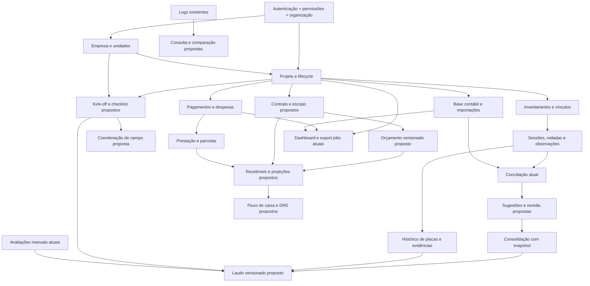

# Auditoria comparativa — legado Netlify e GAI

Data: 27/10/2026, America/Sao_Paulo. Natureza: inspeção estática de código e planejamento, sem implementação.

## Resultado executivo

O legado oferece ideias aproveitáveis, sobretudo para preparação do projeto, orçamento, acompanhamento de campo e emissão de laudos. Não é uma base técnica adequada para substituir o GAI. Seu modelo predominante é HTML com JavaScript embutido, objetos JSON e armazenamento no navegador, sincronizados por funções Netlify cujo código não acompanha o export.

O GAI inspecionado já implementa projetos, empresas/unidades, inventariantes e vínculos, itens patrimoniais, base contábil, imagens, pendências, pagamentos, despesas, importações, exportações, sessões/rodadas de inventário, observações, evidências, conciliações versionadas, consolidação, avaliações manuais e prestação de contas. A existência desses módulos foi confirmada por controllers, serviços, entidades e interfaces, não apenas por menus.

As principais lacunas são: dados contratuais estruturados e indicadores comerciais, orçamento com memória de cálculo, kick-off/checklist versionado, coordenação de campo por etapas, sugestões de conciliação por série/descrição/local, avaliação em lote, fluxo de caixa/DRE, laudos e consulta de histórico de alterações. Parte do que parece ausente nas rotas globais existe nas rotas de projeto; não confundir os placeholders globais com inexistência dos módulos.

Recomenda-se evoluir o GAI em incrementos independentes, preservando os serviços atuais. Reaproveitamento significa adaptar regras e experiências de uso após validação; não copiar páginas, autenticação, sincronizador, dados de demonstração ou chaves globais do legado.

## Entregáveis e navegação

| Artefato | Conteúdo |
|---|---|
| [Inventário funcional](inventario-funcional.md) | Análise dos módulos e variantes, campos, ações, regras, fórmulas, dependências e limites |
| [Matriz comparativa](matriz-comparativa.md) | Classificação por capacidade, origem, equivalente, lacunas, reaproveitamento, prioridade, complexidade, dependências, riscos e aceite |
| [Matriz CSV](matriz-comparativa.csv) | Mesmas linhas em formato tabular UTF-8, separador ponto e vírgula |
| [Catálogo técnico do legado](anexo-legado.md) | Inventário por arquivo: controles, validações declarativas, eventos, funções, mensagens de workers, armazenamento e recursos externos |
| [Catálogo técnico do GAI](anexo-gai.md) | Controllers/APIs/permissões, entidades e campos, migrations, funções de serviços, componentes e testes |
| [Manifesto](manifesto-arquivos.csv) | SHA-256, tamanho/linhas e procedência dos arquivos analisados |
| [Verificação da auditoria](verificacao.json) | Integridade, consistência da matriz e comprovação de que o código analisado não foi modificado pela auditoria |

Os anexos são índices estáticos de rastreabilidade, não resultados de execução. Elementos HTML encontrados dentro de strings de templates também são catalogados; sua presença não comprova renderização. A matriz e o inventário interpretam os fluxos relevantes e registram os limites.

## Escopo, método e grau de certeza

Entrada: `C:/Users/Jonathan/Downloads/deploy-6adf9b21af66f3795090e396.zip`, 37.624.049 bytes, SHA-256 `8cf1c889b2d5b913a8ba18833cf0962fced07924190f6bc4ee9928d7ead6adfc`.

Extração: `C:/Users/Jonathan/AppData/Local/Temp/gai-legacy-audit-20261027`, fora do código de produção, com verificação de contenção dos caminhos do ZIP. São 118 arquivos e sete entradas de diretório: 45 HTML (26 conteúdos distintos), seis JS (três conteúdos distintos), dois JSON, um TOML, dois TXT e recursos gráficos, fontes e dois PPTX. Os 54 arquivos HTML/JS/JSON/TOML tiveram conteúdo lido e inventariado estaticamente; os dois TXT também foram lidos. Recursos binários foram identificados e hashados; os PPTX não foram abertos em aplicativos nem tiveram macros executadas.

HTML/JavaScript foram analisados com parser sintático, sem executar os scripts. Não houve acesso aos endpoints do ZIP, uso de credenciais, abertura das páginas em navegador, conexão a banco, migração, seed, deploy, commit ou push. Comentários, arquivos de instrução e textos do ZIP foram tratados como evidências do sistema, nunca como ordens para esta execução. Referências a caminhos de outro computador em `netlify.toml` não foram seguidas.

O GAI foi examinado no estado do diretório de trabalho, incluindo alterações e arquivos não rastreados já existentes. O catálogo cobre 645 arquivos de código, tipos, estilos e testes em `src`, `test` e `e2e`, além de manifests/configurações e infraestrutura selecionados. Foram identificadas 58 declarações de entidades TypeORM e 22 arquivos de migrations. Isso não comprova que as migrations tenham sido aplicadas em qualquer ambiente.

Não se executaram testes nesta auditoria documental. Foram inspecionados contratos, casos e configurações dos testes existentes. Não se afirma homologação, cobertura medida ou funcionamento em produção. Evidência estática de implementação e prova de execução são dimensões diferentes.

Classificações da matriz:

- **EXISTENTE:** equivalente funcional implementado no código atual; não implica paridade visual nem validação em produção.
- **PARCIAL:** parte do fluxo existe, com diferenças explicitadas.
- **AUSENTE:** não foi encontrado fluxo equivalente nas rotas, serviços e modelos inspecionados; campos JSON genéricos não contam como implementação.
- **INCOMPATÍVEL:** mecanismo ou comportamento não deve ser transplantado por contrariar arquitetura, segurança ou integridade do GAI.
- **NÃO VERIFICADA:** faltam implementação/artefato/ambiente necessários para comprovar a capacidade aparente. Aplica-se, por exemplo, à execução das funções Netlify ausentes.

`P0` é pré-requisito de integridade/segurança; `P1` benefício operacional alto; `P2` expansão de gestão; `P3` escopo adjacente. Complexidade `B/M/A/MA` é estimativa relativa, não compromisso de prazo. Linhas referem-se ao snapshot auditado. `L` nas evidências significa a raiz temporária do legado; `B` significa `gai-backend/src`; `F` significa `gai-frontend/src`.

## Diagnóstico técnico do legado

| Aspecto | Evidência e consequência |
|---|---|
| Aplicação estática e duplicação | 19 pares HTML idênticos entre `paineis/` e `dashboards/`; `fluxo_caixa.html` e `fluxograma_curso.html` diferem. Variantes de conciliação não são intercambiáveis. Não há fonte de verdade única por nome de arquivo. |
| Dados e vínculos | Arrays de objetos e matrizes `{head,rows,meta}`, IDs gerados no cliente e vínculos por nomes, e-mails e sufixos de ano. `inventario.html:529` constrói `inv::<nome do projeto>::<base>`. Renomeações exigem rotinas de reparo. |
| Persistência | `localStorage`, `sessionStorage`, IndexedDB `conciliacao_db/bases` e `desp_anexos`. Limites de quota são tratados por cópias, expurgos e fallbacks; não há transação entre os módulos. |
| Sincronização | `sync-remoto.js:35`, `85`, `105`, `138`, `183`, `218`, `276`: merge por ID, pendências por timestamp, tentativas, polling e interceptação de `Storage.prototype`. Comentário inicial promete nunca descartar local, mas `96–97` dá precedência ao servidor mais recente. O comportamento, não o comentário, é a evidência. |
| Backend incompleto no export | Clientes de `/.netlify/functions/dados`, `/.netlify/functions/conc-db`, `/api/auth` (`index.html:301`) e `/api/permissoes` (`:180`). Não existem implementações nem redirects correspondentes comprovados no ZIP; `netlify.toml` tem redirects vazio. Não se pode comprovar autorização, retenção, atomicidade, validação ou disponibilidade do serviço. |
| Autenticação inadequada para reaproveitar | `index.html:319–377`, `804–854`, `1437–1475`: login local/fallback e export de contas com campo de senha; há tentativa posterior de purgar senhas, mas coexistem caminhos inseguros e JSON de contas público. Não transcrever ou reutilizar valores. |
| Autorização no navegador | `pendencias_campo.html:461–467`, `laudo.html:251–256`: confiança em flags/role do localStorage. Ocultar botão ou liberar iframe não é controle de acesso no servidor. |
| Demonstração e remendos | Rotinas de seed, purga, geração de anexos/PDF fictícios e monkey patches repetidos. Exemplos: `inventariantes.html:896`, `despesas_projetos.html:1394`, `remuneracao_tecnico.html:1570+`. Há rotinas conflitantes e exclusões na abertura. |
| Relatórios | XLSX local, JSON/ZIP, PPTX por manipulação de template, HTML para impressão e HTML com extensão `.doc`. O laudo não é um gerador DOCX nativo nem comprova PDF assinado. |
| Dependências externas | Chart.js, SheetJS, JSZip, bibliotecas de captura/proposta, fontes/CDNs e consultas de logos. Bibliotecas remotas não foram baixadas/executadas. Disponibilidade e comportamento dessas dependências permanecem fora da comprovação. |
| Testabilidade | Nenhuma suíte de testes ou projeto de build/backend acompanha o export. Parsers aceitam a sintaxe dos scripts, o que não valida DOM, bibliotecas, chamadas remotas ou regras financeiras. |

## Arquitetura encontrada no GAI

### Backend, dados e infraestrutura

`gai-backend/package.json` declara NestJS 11, TypeScript, TypeORM 0.3, MySQL/mysql2, class-validator/class-transformer, Argon2, throttler, Pino, SES e SheetJS. `B/app.module.ts:129+` configura MySQL e registra os módulos e entidades; `B/main.ts:13–43` define `/api/v1`, CORS, `ValidationPipe` com whitelist/transform/forbidNonWhitelisted e Swagger em `/api/docs`.

O desenho é um monólito modular. Módulos mais antigos têm `domain` (entidades/ports), `application` (use-cases/DTOs/services), `infrastructure/persistence` (entidades TypeORM/repositories) e `presentation` (controllers). Nem todos seguem a mesma profundidade: `inventory-operations` usa um serviço transacional grande com repositories TypeORM diretos; `expense-accountabilities` concentra controller/DTO/entity/service na raiz do módulo. Não presumir camadas inexistentes ao planejar arquivos.

As entidades operacionais usam IDs numéricos, `organization_id`, `project_id` quando cabível, datas, ator e logs específicos; parte delas usa soft-delete. `B/common/persistence/entity-id.columns.ts:1–10` diferencia IDs integer nos testes e bigint unsigned no MySQL. `data-source.ts` e `scripts/data-source.prod.cjs` mantêm `synchronize:false`; a configuração de AppModule só habilita sincronização no ambiente de teste.

Há migrations de organizações/auth/RBAC, projetos, inventariantes/vínculos, inventário/imagens, catálogo, base contábil, pendências, pagamentos/despesas, importações, empresas/unidades, exportações, índices de dashboard, operações e prestação de contas. As mais recentes existentes são `1741400000001-close-inventory-operation-gaps.ts` e a correção local não rastreada `1793000000001-fix-evidence-storage-key-index.ts`. Não foram criadas nem executadas nesta auditoria.

`infra/terraform` descreve AWS ECS/Fargate, ECR, ALB, RDS, S3 e CloudFront, IAM e redes. Isso evidencia infraestrutura declarada; não comprova recursos ativos. S3 de frontend/assets tem versionamento e bloqueio de acesso público declarados. Os workflows de deploy existentes não foram acionados.

### Frontend e componentes

React 19, TypeScript, Vite 6, React Router 7, TanStack Query, Axios, React Hook Form/Zod, Tailwind, Radix e Recharts estão declarados no manifesto e aparecem no código. `F/router/router.tsx:27–86` é o registro real de rotas. Features de projeto incluem resumo/dashboard, itens, base contábil, pendências, financeiro, prestação de contas, importações/exportações e sessões/rodadas.

`F/api/endpoints.ts` contém os clientes de API; `http.ts:23–45` injeta o Bearer e trata 401. Queries/mutations vivem nas respectivas features. `components/base` oferece DataTable, Pagination, FilterPanel, FormField, Cards, Tabs, States e cabeçalhos; `components/ui/dialog.tsx:30–70` oferece DrawerForm e ConfirmDialog, além dos dialogs e botões em `components/ui`. Preservar esses componentes, `styles/globals.css`, tokens de tema e layouts; não portar CSS global do ZIP.

As rotas globais de catálogo/itens/imagens/base contábil/pendências/pagamentos/despesas/importações/exportações, perfil e configurações têm placeholders (`router.tsx:71–81`). Há implementações reais correspondentes por projeto, exceto a UI global de catálogo. A rota `projects/:projectId/area` também é placeholder; `summary` é a área consolidada efetiva.

### Autenticação, autorização e organizações

O GAI usa sessão opaca com Bearer, não JWT presumido: `SessionAuthGuard:87–160` consulta sessão ativa, usuário apto a login, organização ativa, renova expiração e resolve papéis/permissões. Login usa o port de hash implementado por Argon2; reset possui tokens persistidos, validade e envio SES. O cliente guarda token/usuário em **sessionStorage** (`F/api/session-storage.ts:3–27`), e revalida via backend. Não existe motivo para copiar contas ou fallback offline do legado.

Papéis confirmados: `PLATFORM_ADMIN`, `ORG_ADMIN`, `ORG_USER`. Papéis organizacionais adicionais são persistidos e associados a permissões. `TypeOrmPermissionResolver:36–121` considera usuário/organização/papéis ativos e compatibilidade do escopo. ORG_ADMIN resolve permissões de escopo ORGANIZATION; PLATFORM_ADMIN resolve todas. `PermissionsGuard:49–67` tem bypass para plataforma e para ORG_ADMIN quando nenhuma permissão requerida é de plataforma; chaves novas precisam existir no catálogo para evitar tratamento permissivo de escopo desconhecido.

O isolamento não depende apenas de `OrganizationScopeGuard`: esse guard só compara parâmetro explícito de organização. `ProjectScopeService:12–105` resolve organização dos filtros/criação e valida projeto; serviços como `InventoryOperationsService.getProject:1219–1242` fazem a checagem antes de operações. Vínculos de inventariantes validam a mesma organização (`assign-project-field-agent.use-case.ts:62–103`). Novos endpoints devem repetir essa cadeia, incluindo todos os IDs filhos, downloads, exports e consultas agregadas.

O overview novo é específico de **ORG_ADMIN com organização**: `OrganizationOverviewService.query:23–50` recusa outros papéis, não aceita organização do query e usa a organização do ator. `DashboardPage.tsx:18` direciona esse perfil à nova tela. Seus totais, status, mapa e grupos por empresa têm implementação; os indicadores contratuais retornam `null` (`overview:75`). Ano/mês usam `created_at`, enquanto o legado usa dados contratuais/ano comercial. Essa diferença precisa ficar explícita ao usuário.

### Regras já implementadas que devem ser preservadas

| Capacidade | Evidência concreta |
|---|---|
| Lifecycle de projeto | `projects/domain/services/project-status-transition.policy.ts`; endpoints activate/pause/resume/deactivate/reactivate/finish/cancel/archive |
| Reinventário preserva evidência | `inventory-operations.service.ts:359–593`, observação por rodada, vínculo ativo, `priorObservationId`, idempotência por organização e unique por rodada/item |
| Conciliação atual | `inventory-operations.service.ts:872–1006`: última observação por item, placa normalizada, duplicidades e sobras; run_number transacional |
| Consolidação | `:1036–1097`: bloqueia duplicidade e reconsolidação, grava decisão e snapshot; não altera automaticamente o cadastro mestre |
| Avaliação manual | `:1099–1141`: fonte, data, valor novo/usado, pelo menos um valor, autoria e histórico; UI em `ItemEvidencePanels.tsx:17` |
| Remuneração | `payments-expenses/domain/entities/field-agent-payment.ts:191–208`: dias × diária + adicional − desconto, dinheiro em strings decimais, total não negativo |
| Pagamento | Entidade `:77`, `:94–150`: edição de pendente; baixa de pendente/aprovado; pago não cancelável. Não reduzir a simples troca livre de status do legado. |
| Prestação de contas | `expense-accountabilities.service.ts:145–282`: técnico/período/organização/projeto, despesa única por prestação, total recalculado ao fechar, bloqueio de prestação fechada |
| Parcelamento | `installment-allocation.policy.ts:2–9`: preserva centavos; `generateInstallments:284–341` impede segunda geração e cria vencimentos mensais |
| Importação | Parsers de base contábil e observação física, sessões/payloads, idempotência, erros e reprocessamento; não é importação indiscriminada de qualquer coluna do legado |
| Exportação | `export-workbook-builder.service.ts:31–81`: XLSX de itens, contábil, pendências, pagamentos, despesas e backup; processor tem claim/retry/cancelamento/expiração |
| Dashboard operacional | `project-dashboard-analytics.service.ts` e repository: filtros, produtividade, status, unidades, geografia e qualidade; `evaluated` representa inventariado. Não equivale à avaliação financeira `asset_valuations`. |

### Testes existentes e limites

O anexo lista 119 arquivos de testes (92 backend, 27 frontend) e nomes dos casos encontrados. Há testes unitários e de integração no backend, testes React/Vitest e Playwright no frontend. `test/integration/test-app.helper.ts:100–152` usa SQLite `:memory:` e esquema sincronizado; isso não comprova DDL, locking e índices do MySQL real. Há testes específicos de migrations e da entidade de evidência.

Casos relevantes inspecionados: RBAC/multi-tenancy/auth, escopos de organizações, vínculos, lifecycle de projeto, importações, operações/reinventário/idempotência/evidências, conciliação/consolidação, prestação/parcelas, financeiro, export jobs e dashboard. Os testes de overview incluem filtros cruzados, empresa/UF sem duplicação, escopo e CSV/XLSX com neutralização de fórmulas. Os testes React usam mocks; `e2e/app.spec.ts` intercepta a API e não é prova de integração real. `e2e/homologation-real.spec.ts:3` condiciona execução à configuração externa.

CI (`.github/workflows/ci.yml`) declara lint/test/build e audit de dependências. O `npm audit ... || true` não bloqueia vulnerabilidades, e Playwright não aparece nesse workflow. Nenhum desses checks foi executado aqui.

## Mapa de dependências

Toda seta que cruza módulos exige identidade por ID e organização, autorização no servidor e consistência de estados. O orçamento pode existir sem contrato; convertê-lo em projeto/recebíveis é um incremento posterior. Kick-off pode existir sem orçamento. Laudo pode começar com cadastro e avaliações atuais, deixando conciliação avançada como enriquecimento opcional. Fluxo de caixa depende de recebíveis reais; não inferi-los do total de despesas nem preencher receita com valores simulados.

## Plano incremental priorizado

As rotas/arquivos novos abaixo são **propostas**, ainda inexistentes. As mudanças de banco são necessidades futuras a especificar e aprovar na respectiva execução; nenhuma migration foi criada aqui. Cada incremento deve ter feature flag/rota própria quando necessário, contrato de API documentado e rollback de aplicação sem apagar evidências existentes.

| Fase | Entrega independente e prioridade | Camadas, APIs, banco, permissões e arquivos | Riscos e validação/aceite |
|---|---|---|---|
| 0A | Fechar contratos e baseline — P0, M | Só análise/testes/configuração; `project-dashboard.controller.ts`, `project-summary.service.ts`, `PermissionsGuard`, signer, DTOs, parsers e testes citados. Sem nova funcionalidade necessária para registrar decisões. | Definir acesso a totais financeiros via `projects:read`, serviço de storage real, política para chaves de permissões desconhecidas e envelope de conciliação. Aceite: contratos assinados pela equipe, testes negativos previstos, nenhuma mudança de comportamento silenciosa. |
| 0B | Homologar base existente — P0, M | Somente validação de backend/frontend e banco descartável MySQL; migrations **existentes**, serviços e testes de operações/contas. Não tocar dados de produção. | Concorrência, fuso, índices e fim de mês. Aceite: casos de isolamento A/B, idempotência, reenvio, pagamentos e 31/jan→fev reproduzidos, resultado registrado. |
| 1A | Melhorias de consulta locais — P1, B/M | Somente frontend: seletores com nomes no lugar de IDs, preferências de colunas/filtros, atalhos entre módulos existentes; `features/accountabilities`, `inventory-operations`, `shared`, `components/base`. Sem nova API/banco/permissão se usar contratos existentes. | Paginação não pode carregar silenciosamente só a primeira página. Aceite: filtros/reset/refresh, loading/erro/vazio, teclado e permissões mantidos, dados salvos iguais antes/depois. |
| 1B | Contrato/escopo estruturados — P1, A | Backend+frontend+novas APIs+alteração de banco futura: módulo proposto `project-contracts`, DTOs e regras de contrato/parcelas; integração com `projects`, `companies`, overview, `ProjectForm`, `types/api.ts`, `api/endpoints.ts`, permissions seed. Campos consultáveis não devem ficar soltos em metadata. | Retrocompatibilidade e dado desconhecido versus zero. Aceite: contrato opcional para projetos antigos, valor decimal, versão/aditivo, total de parcelas íntegro e isolamento; overview continua exibindo indisponível onde não há contrato. |
| 1C | Kick-off e checklist do cliente — P1, A | Novo módulo `project-preparation` com templates versionados, respostas e checklist por projeto, APIs e banco futuros; rota de projeto e componentes atuais. Permissões propostas `project-preparation:read/write/approve`; vínculo com unidades e escopo. | IDs estáveis para perguntas; mudar template não pode reinterpretar resposta anterior. Aceite: snapshot da versão, N/A explícito, bloqueios condicionais testados, clonagem sem cruzar organizações. |
| 1D | Checklist de campo — P1, M/A | Incremento sobre preparation, APIs/banco/permissões futuros; integrar `pending-issues` por referência, sem confundir tarefa de coordenação com ocorrência de ativo. UI `features/project-preparation` proposta, resumo atual. | Não importar responsáveis pessoais fixos; não herdar conclusão parcial escondida. Aceite: etapas obrigatórias configuradas, progresso auditável, histórico de reabertura e nomes autorizados; pendências atuais permanecem. |
| 2A | Sugestões de conciliação — P1, A/MA | Backend primeiro: serviço proposto `reconciliation-suggestions` em `inventory-operations`, APIs de simular/revisar/aprovar, banco futuro para regra/score/pares/versão/revisor; depois UI em `InventorySessionDetailPage` e queries/types. Permissões específicas de sugerir/aprovar. | Pareamentos incorretos, muitos-para-um, dados obsoletos. Aceite: placa/série e similaridade explicáveis, revisão obrigatória, duplicidade bloqueada, autorização por organização, idempotência, nenhuma sobrescrita de observação ou mestre. |
| 2B | Agrupamentos e avaliação em lote — P1/P2, M/A | Agrupamento só frontend **apenas quando conjunto completo e pequeno já estiver disponível**; caso geral: backend com agregação paginada. Avaliação em lote: nova API e UI, reutilizar `AssetValuationEntity`, provavelmente sem nova tabela, com autoria/transação e permissão atual ou específica após decisão. | Seleção entre páginas e lotes parciais. Aceite: escopo do lote explicitado, exclusão de itens proibidos, relatório por item e mesma regra de valor/fonte/data; não editar histórico. |
| 2C | Remuneração/pagamentos consolidados — P1/P2, M/A | Reutilizar `payments-expenses`; UI e API de resumo por técnico/competência e ações em lote, sem mudar máquina de estados. Novos endpoints; banco pode não mudar para consulta. Export jobs reutilizados. | Duplicação de pagamento e bypass de aprovação. Aceite: totais batem com detalhes, transições atuais e auditoria por item, retry não paga duas vezes; filtros em organização com vários projetos. |
| 2D | Adiantamentos e reembolsos — P1/P2, A | Novo modelo financeiro futuro para adiantamento, prestação vinculada, solicitação e recebimento do cliente; integrar `expense-accountabilities`/`payments-expenses`, APIs, banco e permissões específicos. | Confundir reembolsável, solicitado e recebido; dupla contagem. Aceite: saldos por técnico/projeto, trilha de liquidação, reabertura controlada e soma reconciliável em centavos. |
| 3A | Orçamento com memória de cálculo — P2, A | Novo módulo `budgets` backend/frontend, APIs, banco, templates/regras versionados, permissões. Reusar empresas/unidades e preços parametrizados por organização. Depois conversão explícita em contrato/projeto. | Piso, produtividade fracionária, tributo e margem não validados. Aceite: fixtures sintéticas aprovadas, todos os termos da memória reproduzíveis no backend, versão preservada e entrada+parcelas=total; sem importar defaults comerciais automaticamente. |
| 3B | Recebíveis e fluxo de caixa — P2, A/MA | Novo módulo proposto `cash-flow`/recebíveis, APIs, banco e permissões; integrar contrato, aditivos, pagamentos, despesas/parcelas e reembolsos. UI de realizado/projetado e filtros. | Regime de caixa versus competência, dupla contagem do contrato e parcelas. Aceite: origem única por movimento, baixa idempotente, estorno auditado e saldo por data/projeto/organização conciliável. |
| 3C | DRE e cenários — P2, MA | Backend+frontend e modelo futuro de plano de contas, competência, parâmetros e cenários versionados; APIs agregadas e importação controlada. Integra caixa/recebíveis e orçamento; permissões financeiras restritas. | Fórmulas históricas fixas do legado e projeção apresentada como real. Aceite: política temporal explícita, realizado separado de cenário, percentuais/divisão por zero testados e aprovação financeira. |
| 4A | Laudo estruturado — P2, A | Novo módulo `technical-reports`, APIs/banco/templates/permissões; snapshot dos itens/avaliações/conciliação e autoria; frontend com preview. Integra empresas/unidades/preparation e export jobs. | Dado mutável alterar documento emitido; texto normativo não validado. Aceite: rascunho/revisão/emissão, pendências de emissão explícitas, versão imutável, evidências autorizadas e ausência de dados de outra organização. |
| 4B | Arquivos profissionais — P2, A | Processamento de arquivos backend isolado/worker: DOCX/PDF/PPTX/ZIP reais conforme formato escolhido; estender export jobs e storage; templates por organização e permissão de download. | CPU/memória, arquivos maliciosos, fidelidade visual/licenças. Aceite: renderização visual de amostras, limites, expiração, checksum, nenhum script no documento, binários válidos e download autorizado. |
| 4C | Histórico consultável — P2, M/A | Backend+frontend: API paginada de logs existentes e comparação; começar somente leitura, com permissões propostas `audit:read`. Restauração é outro incremento, com regras de domínio e concorrência. | Logs podem conter dados sensíveis e não guardar snapshot completo. Aceite: escopo por organização/recurso, campos sensíveis omitidos, trilha de ator/data/ação; restauração nunca por gravação bruta de JSON. |
| 5A | Atividades e jornada — P3, A/MA | Módulo novo e independente, APIs/banco/permissões de próprio/gestor, vínculos com users/projects, timezone e calendário configuráveis. Não atrelar login automaticamente a início de jornada. | Privacidade, intervalos sobrepostos e relógio do cliente. Aceite: servidor determina tempo, solicitações retroativas auditadas, autorização por sujeito, calendário aprovado e regras de pausa testadas. |
| 5B | CRM/cursos — P3, A | Inbound/outbound, cursos e funil são domínio adjacente, novo módulo ou integração futura; APIs/banco/permissões próprios. Não incluir implicitamente no escopo patrimonial. | Ampliação de escopo e dados de contato. Aceite: decisão de produto, consentimentos/política de dados definidos, isolamento e deduplicação verificáveis. |

Somente backend pode ser entregue primeiro nas fases 2A/2B (contratos/testes do motor e lote), sem expor botões ainda sem ação. Novas APIs e mudanças de banco/permissões são explicitadas acima; fase 1A é o ganho imediato que pode ser apenas frontend. Todas as mudanças de regras/estado/arquivos requerem testes automatizados de domínio, autorização, integração e regressão; mudanças visuais reversíveis podem se limitar a verificações de UI apropriadas.

## Riscos de segurança e integridade

| ID | Risco e evidência | Tratamento recomendado, sem execução nesta auditoria |
|---|---|---|
| S01 | Credenciais e flags client-side no legado, incluindo JSON de contas e login local | Não migrar contas/senhas/sessões. Validar exposição dos acessos originais com seus responsáveis e aplicar a política de credenciais da organização. Não publicar o ZIP ou os valores no relatório. |
| S02 | Ausência de organização nas chaves e sincronização global (`sync-remoto.js:261–290`) | Nunca portar namespaces/chaves globais; resolver organização no servidor, validar recurso pai/filho e escopar agregados e arquivos. |
| S03 | Merge genérico ressuscita excluídos e timestamp depende do cliente | Usar transações, estados, idempotência, versões e conflitos de domínio do GAI. Desfazer deve ser comando compensatório autorizado, não restauração de arrays inteiros. |
| S04 | Seeds, purgas e anexos demonstrativos no boot do legado | Criar apenas fixtures sintéticas em testes; proibir dados embarcados, purga automática e documentação fictícia em produção. |
| S05 | GAI: totais financeiros do summary exigem só `projects:read` (`controller:52–66`, `service:94–96`) | A leitura do código indica exposição possível a usuário com projeto sem leitura financeira se ele solicitar include_financial. Validar política com caso de autorização negativa antes de ampliar dashboards; o tenant continua sendo verificado. Não é prova de exploração. |
| S06 | GAI: signer usa HMAC próprio e fallback para endpoint inválido (`configured-storage-signer.service.ts:19–35`) | Não afirmar compatibilidade S3 SigV4. Homologar serviço que verifica X-GAI-* ou adotar adapter compatível com storage definido, na execução apropriada. Upload/confirm não prova existência do binário. |
| S07 | GAI: ORG_ADMIN bypass de permissões quando scope de chave desconhecida não é PLATFORM (`PermissionsGuard:53–60`) | Registrar todas as permissões novas; validar fail-closed para chave ausente e diferenças de papel/permissão, preservando contrato atual até decisão. |
| S08 | Planilhas/templates/documentos controlados pelo usuário, HTML/URLs/arquivo volumoso | Validar MIME/extensão/conteúdo, limites de bytes/linhas/descompressão, escape de HTML, neutralização de fórmulas em CSV/XLSX e URLs de download; não executar JS nem macros. Confirmar em cada parser/exporter, não apenas no overview já testado. |
| S09 | `Number`/toFixed, datas locais/UTC e setUTCMonth em parcelas | Testar precisão, limites monetários, 31/jan, bissexto, timezone e arredondamentos. Não tomar fórmula do navegador como verdade financeira. |
| S10 | Snapshot de consolidação é decisão registrada, não atualização automática de cadastro | Preservar observações e placas mestres; definir aplicação de correção como ação separada se produto precisar. Evitar copiar substituição massiva de códigos do ZIP. |
| S11 | Dependências CDN e textos que citam CPC/CREA/ART | Revisar licença/proveniência e conteúdo com responsáveis; referências em texto/checkbox não comprovam cálculo normativo, laudo válido ou assinatura digital. |
| S12 | Testes SQLite/mocks e arquivos locais não versionados | Homologar MySQL/storage/serviços reais em ambiente descartável autorizado; usar o manifesto para identificar o snapshot. Não inferir estado de produção por relatórios anteriores do repositório. |
| S13 | Fallback da avaliação legada para base sem projeto (`conciliacao_fisico_contabil_avaliacao2.html:2171–2177`) | O código tenta a base do projeto e depois `inv::sem-projeto::inv`, `proj::sem-projeto::inv` e `inv`. Pode importar base de origem ambígua; nunca portar esse fallback. Exigir IDs de organização/projeto/sessão e origem da base em toda importação. |

## Pontos que precisam de validação

1. Qual variante de conciliação e de fluxo/DRE representa a regra de negócio desejada? O ZIP contém versões funcionalmente diferentes, sem fonte autoritativa declarada.
2. Quais funcionalidades estão de fato em uso e quais dados embarcados são reais versus demonstração? Não assumir que seeds são registros de negócio confiáveis.
3. Contrato deve ter ano/data próprios, segmento, origem, recorrência, escopo, quantidade contratada, aditivos e cronograma de recebimento? Como relacionar com criação/conclusão do projeto?
4. “Em aberto” significa active, todos os não terminados ou outro conjunto? O overview atual conta apenas ACTIVE.
5. No inventário, “inventariado” deve continuar sendo status evaluated ou ser calculado por observações? Avaliação financeira é conceito separado.
6. Qual versão da base contábil e qual rodada/observação são elegíveis para cada execução de conciliação? Como tratar not_found/divergent com placa preenchida, duplicidades e candidatos de valor alto?
7. Série, descrição, local e unidade têm qualidade e campos suficientes para pareamento? Score padrão 60% e desempate por maior valor precisam aprovação; não são regras universais.
8. Agrupamentos e indicadores precisam contar linhas, bens ou placas distintas? Base contábil pode ter componentes/várias linhas para um bem.
9. Valores novo/usado precisam de evidência de pesquisa, moeda, validade, depreciação ou revisão técnica? O GAI atual só registra avaliação manual; o legado também não comprova cálculo automático de valor justo.
10. Piso de orçamento de R$ 21.000, diárias/produtividade, faixas, arredondamento da equipe, gross-up, comissões e calendários são políticas válidas? Devem ser parametrizadas por organização e versionadas.
11. Quais etapas são obrigatórias para finalizar campo? No legado só as duas primeiras faixas contam; isso não equivale a todas as verificações concluídas.
12. Qual diferença entre reembolsável, solicitado ao cliente, recebido, depositado ao técnico e prestação encerrada? Modelar cada evento, sem equivalência automática de labels ambíguas.
13. Pagamento pode ser baixado diretamente de pendente como hoje no GAI? Há necessidade de segregação entre criação/aprovação/baixa para ORG_ADMIN e papéis customizados?
14. Qual política de competência/caixa, plano de contas, tributos, custos fixos e projeção? Não transportar os cortes setembro/2026 e divisores fixos do legado como regra fiscal.
15. Quais públicos e formatos de laudo/proposta (PDF/DOCX/PPTX) precisam existir? Quais assinaturas, revisão e retenção são exigidas? A presente auditoria não faz validação normativa ou jurídica desses textos.
16. As funções Netlify originais, backend do app móvel e APK podem ser fornecidos em outra análise? O ZIP não contém suas implementações/instalador. Não testar credenciais do export.
17. Como o storage configurado em cada ambiente valida assinatura, tamanho e conteúdo? URLs geradas e confirmações atuais precisam prova em integração real.
18. Deve haver restrição de totais financeiros e logs além de `projects:read`? Deve-se recusar permissão não catalogada?
19. Quais logs guardam antes/depois suficientes para comparação e quais dados exigem mascaramento? Restauração não é equivalente a leitura de audit log.
20. O contrato TypeScript de `inventoryOperationsApi.reconcile` deve ser alinhado ao envelope `{run_number,records}` retornado pelo backend? Inspeção mostra tipo de array no cliente; validar consumidores antes de alterar.
21. A geração de parcelas deve preservar último dia do mês? O setUTCMonth atual pode avançar para março a partir de 31/janeiro; não foi executado contra dados reais.
22. Confirmar quais alterações locais do snapshot serão incorporadas antes de estimar implementação. Em particular, overview ORG_ADMIN e correção de índice existem localmente e não autorizam inferir deploy/aplicação.

As validações pendentes não impedem os incrementos independentes já descritos, mas condicionam regras e integrações que dependam delas. A matriz distingue essas dependências dos fluxos efetivamente implementados.
